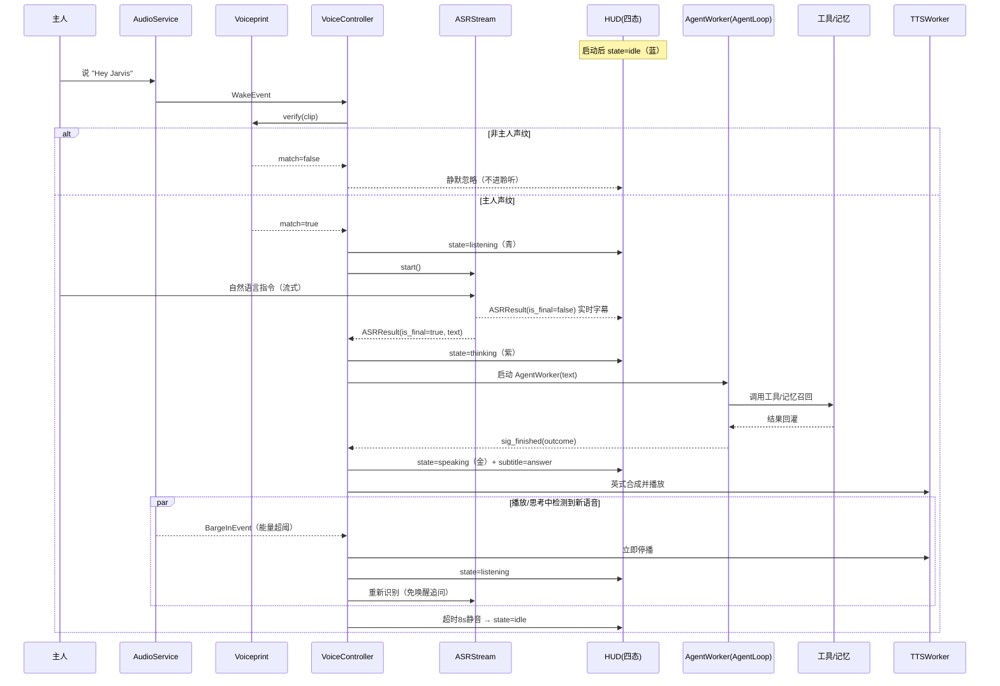
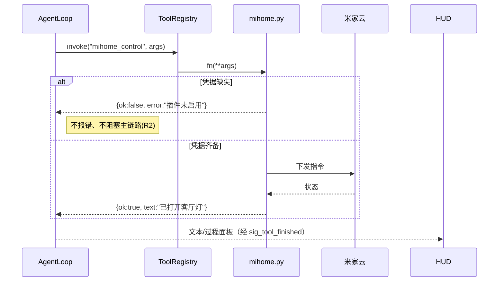
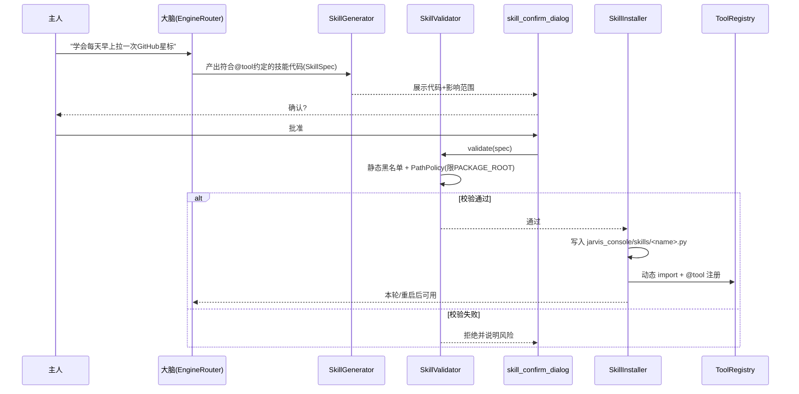
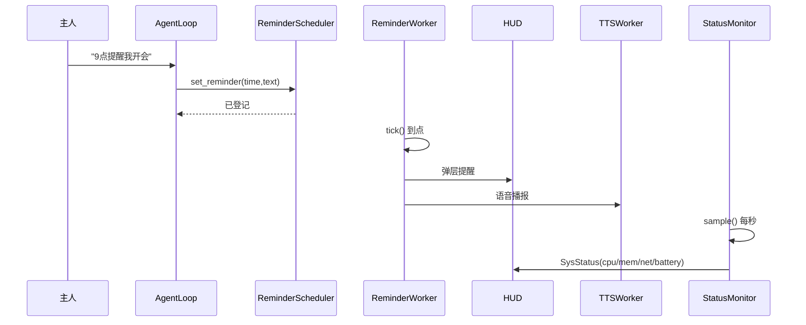

# 融合版 JARVIS v1 · 系统架构设计 + 任务分解

> 文档负责人：架构师「高见远（Gao）」　|　版本：v1.0　|　语言：简体中文
> 上游依据：本地仓库 `jarvis_console/`（PySide6 总控台）、`jarvis/`（唤醒/ASR 骨架）、PRD `jarvis-fuse-PRD.md`、上游 `shitoudaidi/GDDXX-Jarvis`（GPL-3.0，仅参考设计，不照搬受版权保护资产）。
> 定位：融合进现有 `jarvis_console`，不另起炉灶；Windows 独占，双击 `.exe` 运行。

---

## 1. 实现方案 + 框架选型

### 1.1 技术难点拆解

| 难点 | 说明 | 选型 |
|------|------|------|
| 全息 HUD + 3D 演示 | 需要 WebGL、玻璃拟态、四态动效、手势旋转拆装，Qt 原生控件难以低成本实现 | **PySide6 `QWebEngineView` 承载 `Three.js`**（本地内置 `three.min.js`，离线可用；CDN 仅作回退） |
| 完整离线语音闭环 | 唤醒 + 流式 ASR + 声纹 + 打断 + 英式 TTS，全程本地推理 | Python 多线程/异步音频服务（sherpa-onnx 1.12.40 锁版本、sounddevice、webrtcvad、resemblyzer、edge-tts 7.3.1） |
| 大脑多服务商 | DeepSeek/通义/Kimi/智谱/OpenAI/Ollama 统一切换、失败降级 | 把 `EngineRouter` 从「主+兜」扩成 **N 路优先级队列**，新增统一 `OpenAICompatibleClient` 基类 |
| 插件/学会新技能 | 凭据缺失即降级、技能写入白名单内 | 复用 `@tool` 注册器 + `PathPolicy` 白名单 + 静态黑名单审查 |
| 系统状态/日程常驻 | CPU/内存/网络/电量每秒刷新、到点提醒 | 独立 `QThread` 轮询 Worker + JSON 定时器调度 |
| Windows 打包 | 双击 .exe、首启下载 ~1GB 模型、断点续传 | **PyInstaller 出单文件 exe → Inno Setup 6 封装安装器**；首启向导负责模型下载 |

### 1.2 框架与库选型及理由

- **UI 外壳 = PySide6（`QMainWindow` + `QWebEngineView` + `QtWebSockets`）**
  - 现有 `jarvis_console` 已是 PySide6，复用成本最低；`QWebEngineView` 内置 Chromium，天然支持 WebGL 与本地 HTML/JS，可直接承载 Three.js 全息 HUD。
  - HUD 与 Python 之间用 **`QWebSocketServer`（Qt 原生，无额外依赖）** 走 `ws://127.0.0.1:8765` 的 JSON 消息桥（对齐上游 GDDXX-Jarvis 的 WebSocket 约定）：Python 推 `HUDState`，HUD 回传 `text`/`interrupt` 等。
  - 现有 `ChatView`/`TraceView`/`EngineBadges`/`IngestBanner`/`MemoryIndicator`/`ControlPanel` 不重写，作为「控制台子面板」以可收起的 `QDockWidget`/叠加层嵌入 HUD 左侧或底部，满足 PRD「叠加而非取代」。

- **语音服务 = Python 线程 + 回调/队列**（不在主线程碰音频与模型）
  - `sherpa-onnx==1.12.40` 已锁版本，承担**唤醒关键词 spotting** 与 **sensevoice 离线流式 ASR**；严格遵守「`chdir` 到模型目录 → 传纯文件名 → `finally` 恢复 cwd」纪律（复用 `speech/asr.py::load_model_safely`）。
  - `sounddevice`（PortAudio）做麦克风采集，`webrtcvad` 做能量/语音活动检测以实现 **barge-in 打断**与**免唤醒追问**。
  - `resemblyzer` 做轻量本地声纹（d-vector 余弦比对），本地推理、无密钥、体积小。
  - `edge-tts==7.3.1` 默认英式嗓音（`en-GB`），后端可插拔（可选合规 Piper 英式）；`prepare_speech_text` 摘要逻辑不动，长文仍只播 ≤80 字。

- **3D 渲染 = Three.js（本地 vendored）**
  - 理由：与 PySide6 外壳解耦、手势旋转/拆装实现成本低、性能与生态成熟、与上游一致；**离线优先**要求不依赖 CDN，故把 `three.min.js` 随包内置到 `hud/vendor/`，CDN 仅当本地缺失时回退。

- **打包 = PyInstaller + Inno Setup 6**
  - PyInstaller 把 Python 应用打成单目录/单文件 exe（模型权重**不进包**）；Inno Setup 6 负责 Windows 安装器（开始菜单项、卸载、首次运行触发模型下载向导）。

### 1.3 架构分层

```
┌──────────────────────────────────────────────────────────────┐
│  UI 层 (PySide6 QMainWindow)                                   │
│   ├─ HUD (QWebEngineView + Three.js 四态/皮肤/3D 演示)          │
│   ├─ 控制台子面板 (Chat/Trace/Badges/Ingest/Memory/Status)      │
│   ├─ 设置 (服务商选择器/皮肤选择器/声纹/插件Key)                │
│   └─ 首启向导 (声纹注册 + 模型下载)                             │
├──────────────────────────────────────────────────────────────┤
│  编排层 (Qt 信号桥)                                            │
│   ├─ VoiceController (QThread: 四态状态机 + barge-in 调度)      │
│   ├─ AgentWorker (复用: 跑 AgentLoop)                          │
│   ├─ TTSWorker (复用 + 可插拔后端)                             │
│   ├─ StatusWorker / ReminderWorker (QThread 常驻)              │
│   └─ HUD WebSocket Bridge (QWebSocketServer)                   │
├──────────────────────────────────────────────────────────────┤
│  服务层 (框架无关)                                             │
│   ├─ AudioService (wake/asr/vad 线程 + 事件队列)               │
│   ├─ Voiceprint (注册/校验)                                     │
│   ├─ EngineRouter (N 路优先级 + 降级) + ProviderClient          │
│   ├─ PluginManager (米家/高德/抖音 凭据驱动启用)                │
│   ├─ SkillManager (学会新能力: 生成/校验/安装/注册)             │
│   └─ ReminderScheduler / StatusMonitor                         │
├──────────────────────────────────────────────────────────────┤
│  内核层 (复用不变)                                             │
│   AgentLoop · ToolRegistry(@tool) · MemoryStore · NoteStore     │
│   Safety(PathPolicy/ConfirmationGate) · MessageBuilder          │
└──────────────────────────────────────────────────────────────┘
```

---

## 2. 文件列表及相对路径（全部落在 `jarvis_console/` 下，标注 新增/修改）

> 相对路径以 `jarvis_console/` 为根。模型路径统一收敛到 `jarvis_console/models/`（见 §7 共享知识），唤醒/ASR 沿用 `jarvis/config.py` 约定后在 `paths.py` 重导出。

### 2.1 修改（复用既有资产，不推倒重写）

| 文件 | 改动要点 |
|------|----------|
| `app.py` | 装配 `VoiceController`、`HUD`、`StatusWorker`、`ReminderWorker`、`SetupWizard`、服务商/皮肤面板；首启检测向导；TTS voice 默认英式。 |
| `config.py` | 新增 `ProviderConfig`/`ProvidersConfig`；`UIConfig.voice` 默认改 `en-GB`；导出 `MODELS_DIR`/`WAKE_MODEL`/`ASR_MODEL`/`PIPER_MODEL`。 |
| `config/console.yaml` | 新增 `providers` 段（6 家默认 base_url/model/env_key/优先级）；`ui.voice: en-GB`；插件与技能相关开关。 |
| `core/llm_client.py` | 新增统一 `OpenAICompatibleClient`（通义/Kimi/智谱/OpenAI 复用）；`EngineRouter` 扩为 N 路优先级队列（`select(provider)` + 自动降级）。 |
| `core/agent_loop.py` | `SYSTEM_PROMPT` 增补：语音/插件可用性/「学会新能力」意图提示；不改推理循环。 |
| `core/safety.py` | 复用 `PathPolicy`/`ConfirmationGate`；技能静态黑名单审查放 `skills/learn.py`（不在此改结构）。 |
| `tools/__init__.py` | 导入 `tools/plugins` 并在 `configure_tools()` 后调用 `sync_plugin_enabled()` 按凭据启用插件。 |
| `tools/systemtools.py` | `system_status()` 增补**网络吞吐**与**电量**（电池 API 本地无网络可用）。 |
| `speech/tts.py` | 抽象 `TTSBackend` 接口：`EdgeTTSBackend`(en-GB) / `PiperBackend`(可选)；保留 `prepare_speech_text`。 |
| `speech/asr.py` | **替换 stub**：实现 sensevoice 流式 ASR（`SenseVoiceStream`），复用 `load_model_safely`；`asr_status()` 返回真实能力。 |
| `workers/tts_worker.py` | 增加 `backend` 参数透传；其余不变。 |
| `workers/agent_worker.py` | 结构不变；`VoiceController` 复用其信号驱动 HUD 状态。 |
| `ui/main_window.py` | 中央部件换为 `HUD`；保留控制台子面板为可收起叠加层；接入语音/状态/提醒/设置入口。 |
| `ui/theme.py` | 在 `DARK_QSS` 基础上补充 HUD 容器/玻璃拟态基础样式（不改现有控件样式）。 |
| `ui/widgets.py` | `EngineBadges` 扩为 N 家服务商；新增 `ProviderSelector`、`SkinPicker`、`VoiceprintButton` 控件。 |
| `ui/status_bar.py` | 现有字段保留；系统状态上 HUD 由 `StatusWorker` 负责，状态栏仅作冗余展示。 |

### 2.2 新增

| 文件 | 作用 |
|------|------|
| `speech/wake.py` | sherpa-onnx 关键词 spotting（"Hey Jarvis"），常驻监听线程，命中发 `WakeEvent`。 |
| `speech/voiceprint.py` | 声纹注册（`VoiceprintEnroll`）+ 校验（余弦阈值），嵌入存 `~/.jarvis/voiceprint.npy`。 |
| `speech/vad.py` | `webrtcvad` 封装：能量/语音活动检测，供 barge-in 与免唤醒追问。 |
| `speech/audio_service.py` | 麦克风采集 + 唤醒/ASR/VAD 线程编排，向队列/回调推 `WakeEvent`/`ASRResult`/`BargeInEvent`。 |
| `workers/voice_controller.py` | **语音编排核心（QThread）**：四态状态机（Idle/Listening/Thinking/Speaking）、驱动 HUD、复用 `AgentWorker`+`TTSWorker`、barge-in 打断。 |
| `workers/status_worker.py` | 每秒轮询 CPU/内存/网络/电量，发 `SysStatus` → HUD。 |
| `workers/reminder_worker.py` | 日程到点触发：TTS + HUD 弹层。 |
| `tools/plugins/__init__.py` | 插件聚合导入 + `sync_plugin_enabled()`。 |
| `tools/plugins/mihome.py` | 米家设备控制（凭据缺失即禁用，R2）。 |
| `tools/plugins/amap.py` | 高德天气 + 路线（R2）。 |
| `tools/plugins/douyin_creator.py` | 抖音创作者开放接口（替代旧 stub，R2）。 |
| `tools/plugins/schedule.py` | 日程提醒工具（`set_reminder`/`list_reminders`/`cancel_reminder`）。 |
| `skills/__init__.py` | 已安装技能加载器（动态 import + `@tool` 注册，限 `PACKAGE_ROOT` 内）。 |
| `skills/learn.py` | `SkillGenerator`（大脑产出技能代码）+ `SkillValidator`（静态黑名单+PathPolicy）+ `SkillInstaller`（写入 `skills/` 并注册）。 |
| `ui/hud.py` | `HUD` 类：`QWebEngineView` + `QWebSocketServer` 桥，加载 `hud/index.html`，推送/接收 `HUDState`。 |
| `ui/hologram.py` | 3D 演示命令桥：按 `demo` 指令加载/卸载 `hud/demos/*.js`。 |
| `ui/skins.py` | `SkinRegistry`：8 套皮肤元数据 + 四态→皮肤映射，下发 HUD。 |
| `ui/provider_panel.py` | 服务商选择器 UI（含「默认/自动」、Key 仅显示是否配置）。 |
| `ui/skin_picker.py` | 皮肤选择器 UI。 |
| `ui/voiceprint_dialog.py` | 声纹注册引导弹窗。 |
| `ui/setup_wizard.py` | 首启向导：声纹注册 →（可选）插件 Key → 模型下载引导。 |
| `ui/skill_confirm_dialog.py` | 「学会新能力」确认弹窗（展示代码+影响范围）。 |
| `ui/reminder_dialog.py` | 新建/查看/取消提醒 UI。 |
| `hud/index.html` | HUD 页面骨架。 |
| `hud/css/hud.css` | 全息蓝青玻璃拟态样式。 |
| `hud/js/boot.js` | 脚本按顺序加载（`PARTS` 列表）。 |
| `hud/js/state.js` | WebSocket 客户端 + 四态状态机 + 字幕。 |
| `hud/js/skins.js` | `SKINS`（8 套：roles/core/coreKind）。 |
| `hud/js/cores.js` | 四态核心动画（`frame(dt)`/`msg(m)`/`dispose()`）。 |
| `hud/js/demos.js` | 3D 演示加载器（`import()` + 消息接线）。 |
| `hud/demos/machine.js` | 机器拆解演示（Three.js）。 |
| `hud/demos/starship.js` | 星舰发射回收演示。 |
| `hud/demos/roadster.js` | Roadster 悬停演示。 |
| `hud/demos/optimus.js` | Optimus 行走演示。 |
| `hud/vendor/three.min.js` | **本地内置** Three.js（离线优先，CDN 回退）。 |
| `hud/media/<demo>/manifest.json` | 演示素材来源与许可（R3）。 |
| `platform/win/build.iss` | Inno Setup 6 安装脚本。 |
| `platform/win/jarvis.spec` | PyInstaller 打包规格（锁定依赖版本）。 |
| `platform/win/first_run.py` | 首启模型下载向导（进度/取消/续传）。 |
| `platform/win/model_manifest.json` | 模型 URL + sha256 + 大小（≈1GB 构成）。 |
| `platform/win/download_models.py` | 断点续传下载器（HTTP Range + 哈希校验）。 |

---

## 3. 数据结构与接口（类图 / JSON Schema）

### 3.1 Mermaid 类图

```mermaid
classDiagram
    %% ===== 数据契约（零 Qt 依赖，可跨线程/跨进程 JSON 序列化）=====
    class WakeEvent {
        +string type = "wake"
        +float timestamp
        +float confidence
        +string clip_ref
    }
    class ASRResult {
        +string type = "asr"
        +bool is_final
        +string text
        +float confidence
        +int start_ms
        +int end_ms
    }
    class BargeInEvent {
        +string type = "barge_in"
        +float energy
        +float timestamp
    }
    class VoiceprintEnroll {
        +string owner_id
        +list~float~ embedding
        +string embedding_path
        +string created_at
        +string status
    }
    class VoiceprintVerify {
        +bool match
        +float score
    }
    class BrainRequest {
        +list~dict~ messages
        +list~dict~ tools
        +string engine
        +int timeout
    }
    class BrainResponse {
        +string content
        +list~ToolCall~ tool_calls
        +string reasoning
        +string finish_reason
        +string engine
        +int prompt_tokens
        +int completion_tokens
    }
    class HUDState {
        +string state
        +string subtitle
        +string engine
        +SysStatus sys
        +string demo
        +string skin
    }
    class SysStatus {
        +float cpu
        +float mem
        +float net_up
        +float net_down
        +float battery
        +bool on_ac
    }
    class PluginSpec {
        +string name
        +bool enabled
        +list~string~ requires
        +string description
    }
    class SkillSpec {
        +string name
        +string description
        +dict parameters
        +string code_path
        +string status
        +string sha256
    }

    %% ===== 服务/控制类 =====
    class WakeEngine {
        +load_model_safely()
        +start(listener)
        +stop()
    }
    class ASRStream {
        +start()
        +feed(audio)
        +stop()
    }
    class Voiceprint {
        +enroll(samples) VoiceprintEnroll
        +verify(clip) VoiceprintVerify
    }
    class AudioService {
        +start()
        +stop()
        -WakeEngine wake
        -ASRStream asr
        -VAD vad
    }
    class VoiceController {
        +run()
        -AudioService audio
        -AgentWorker agent
        -TTSWorker tts
        +on_wake()
        +on_asr_final()
        +on_barge_in()
        -state_machine()
    }
    class EngineRouter {
        +list~EngineSpec~ engines
        +select(provider)
        +chat(req) BrainResponse
        +auto_fallback()
    }
    class OpenAICompatibleClient {
        +name
        +chat(req) BrainResponse
        +available()
    }
    class HUD {
        +QWebEngineView view
        +QWebSocketServer bridge
        +push(state) 
        +on_message(msg)
    }
    class SkinRegistry {
        +dict skins
        +map_state_to_skin(state)
    }
    class PluginManager {
        +sync_enabled()
        +list_specs() list~PluginSpec~
    }
    class SkillManager {
        +generate(intent) SkillSpec
        +validate(spec) bool
        +install(spec) bool
    }
    class ReminderScheduler {
        +add(reminder)
        +cancel(id)
        +tick()
    }
    class StatusMonitor {
        +sample() SysStatus
    }

    %% ===== 关系 =====
    AudioService --> WakeEngine : owns
    AudioService --> ASRStream : owns
    VoiceController --> AudioService : drives
    VoiceController --> AgentWorker : spawns
    VoiceController --> TTSWorker : spawns
    VoiceController --> HUD : push HUDState
    EngineRouter --> OpenAICompatibleClient : routes N
    OpenAICompatibleClient ..|> BrainResponse : produces
    HUD --> SkinRegistry : reads skins
    SkillManager --> PluginSpec : reuses @tool
    ReminderScheduler ..> TTSWorker : triggers
    StatusMonitor ..> HUD : SysStatus
    VoiceprintEnroll <.. Voiceprint : creates
    VoiceprintVerify <.. Voiceprint : returns
    HUDState *-- SysStatus : contains
    BrainRequest ..> BrainResponse : maps to
```



### 3.2 关键 JSON Schema（契约）

- **`WakeEvent`**：`{"type":"wake","timestamp":<epoch_ms>,"confidence":<0..1>,"clip_ref":"<wav_path>"}`
- **`ASRResult`**：`{"type":"asr","is_final":<bool>,"text":"<utf8>","confidence":<0..1>,"start_ms":<int>,"end_ms":<int>}`
- **`HUDState`**：`{"state":"idle|listening|thinking|speaking","subtitle":"...","engine":"DeepSeek|Ollama|...","sys":{"cpu":..,"mem":..,"net_up":..,"net_down":..,"battery":..,"on_ac":<bool>},"demo":<str|null>,"skin":"<skin_id>"}`
- **`BrainRequest` / `BrainResponse`**：直接映射 `EngineRouter.chat(messages, tools, timeout)` 入参与 `LLMResponse`（见 `core/types.py`）。
- **`PluginSpec`**：`{"name","enabled":<bool>,"requires":["MIJIA_TOKEN",...],"description"}`
- **`SkillSpec`**：`{"name","description","parameters":{...},"code_path":"jarvis_console/skills/<name>.py","status":"trial|installed","sha256":"..."}`

---

## 4. 程序调用流程（时序图）

### 4.1 主链路：唤醒 → 声纹 → ASR → 大脑(工具) → TTS → HUD 四态



### 4.2 支线 A：插件调用（以米家为例，在 AgentLoop 内）



### 4.3 支线 B：学会新能力闭环



### 4.4 支线 C：日程提醒 + 系统状态常驻



---

## 5. 有序任务列表（按实现顺序，含依赖与验收）

> 依赖仅指向同一列表内的前序任务；验收标准可对照 PRD 的 JV-P0/P1 编号。

### T1 · 大脑多服务商 N 路路由（P0-04）
- **目标**：把 `EngineRouter` 扩为 N 路优先级队列，新增统一 `OpenAICompatibleClient`，6 家服务商可切换/降级；`SYSTEM_PROMPT` 增补语音/插件/技能提示。
- **涉及文件（修改）**：`config.py`、`core/llm_client.py`、`config/console.yaml`、`core/agent_loop.py`、`tests/test_llm_client.py`
- **依赖**：无
- **验收**：6 家服务商在 `console.yaml` 有默认 base_url/model/env_key；`EngineRouter.select("kimi")` 生效；主引擎不可达按优先级自动降级；`MockLLMClient` 测试仍通过；Key 仅显示是否配置、不回显。

### T2 · 语音输入底座：唤醒 + ASR + 声纹（P0-01/02/03）
- **目标**：实现 sherpa-onnx 离线唤醒、sensevoice 流式 ASR（替换 stub）、声纹注册/校验；严格遵守 `chdir` 加载纪律。
- **涉及文件（新增）**：`speech/wake.py`、`speech/voiceprint.py`、`speech/vad.py`、`speech/audio_service.py`；（修改）`speech/asr.py`、`requirements.txt`
- **依赖**：无（与 T1 可并行）
- **验收**：`WakeEvent` 在离线（无网）下可触发；`ASRResult` 流式字幕可用；声纹注册 ≥1 段后非主人唤醒静默忽略；`sherpa-onnx==1.12.40` 锁版本、中文路径 `chdir` 规则复用 `load_model_safely`。

### T3 · 语音编排控制器与四态状态机（P0-09 支撑）
- **目标**：`VoiceController` 串起 AudioService→声纹→ASR→复用 `AgentWorker`/`TTSWorker`，实现四态切换与 barge-in 打断/免唤醒追问。
- **涉及文件（新增）**：`workers/voice_controller.py`；（修改）`app.py`
- **依赖**：T1、T2
- **验收**：一次「唤醒→聆听→思考→说话→回 idle」闭环；播放/思考中被新语音打断立即停 TTS 转聆听；同轮追问免唤醒；超时 8s 回 idle。

### T4 · 英式 TTS 可插拔后端（P0-05）
- **目标**：`TTSBackend` 抽象，默认 `edge-tts en-GB`，可选 Piper 英式；保留 `prepare_speech_text` 摘要（长文 ≤80 字）。
- **涉及文件（修改）**：`speech/tts.py`、`workers/tts_worker.py`、`config.py`、`config/console.yaml`、`app.py`
- **依赖**：无
- **验收**：默认英式嗓音播报；长文只播摘要；后端可在配置切换；播报失败仅提示不阻断主链路。

### T5 · HUD 全息主界面 + 四态 + WebSocket 桥（P0-06）
- **目标**：`ui/hud.py` 用 `QWebEngineView` + `QWebSocketServer` 承载 `hud/index.html`，实现四态视觉与字幕；现有控制台控件作为可收起子面板。
- **涉及文件（新增）**：`ui/hud.py`、`hud/index.html`、`hud/css/hud.css`、`hud/js/boot.js`、`hud/js/state.js`；（修改）`ui/main_window.py`、`ui/theme.py`
- **依赖**：无（与 T1–T4 可并行，运行时与 T3 对接状态）
- **验收**：四态（idle/listening/thinking/speaking）颜色/动效可清晰区分；对话文本与过程可见；HUD 与 Python 经 `ws://127.0.0.1:8765` 互通；文字输入通道保留。

### T6 · 8 套皮肤（P1-07）
- **目标**：`SkinRegistry` + `hud/js/skins.js`（`SKINS`），四态自动切换对应皮肤动效，设置可手选。
- **涉及文件（新增）**：`ui/skins.py`、`hud/js/skins.js`、`hud/js/cores.js`；（修改）`ui/widgets.py`(SkinPicker)、`ui/skin_picker.py`
- **依赖**：T5
- **验收**：≥8 套皮肤；聆听/思考/说话三态随皮肤变化；设置内可手动选皮肤并即时生效。

### T7 · 3D 全息演示（P1-08）
- **目标**：Three.js（本地 vendored）实现机器拆解/星舰发射回收/Roadster 悬停/Optimus 行走 4 场景，鼠标/触控手势旋转、缩放、拆装；帧率 ≥30fps。
- **涉及文件（新增）**：`ui/hologram.py`、`hud/js/demos.js`、`hud/demos/{machine,starship,roadster,optimus}.js`、`hud/vendor/three.min.js`、`hud/media/<demo>/manifest.json`
- **依赖**：T5
- **验收**：4 个演示可唤起；手势可旋转/缩放/拆装；离线可用（three 本地）；素材来源/许可在 manifest 标注（R3）。

### T8 · 系统状态实时上 HUD（P1-01）
- **目标**：`system_status()` 增补网络吞吐与电量；`StatusWorker` 每秒采样推 HUD。
- **涉及文件（修改）**：`tools/systemtools.py`；（新增）`workers/status_worker.py`；（修改）`app.py`、`ui/main_window.py`
- **依赖**：T5
- **验收**：CPU/内存/网络/电量每秒刷新；断网时网络/电量仍本地显示；低电量/掉线有提示态。

### T9 · 日程提醒（P1-02）
- **目标**：`schedule.py` 工具 + `ReminderWorker` 到点触发 TTS+HUD 弹层；支持「N分钟后/今天HH:MM/每天HH:MM」与查看/取消；落 `~/.jarvis/reminders.json`。
- **涉及文件（新增）**：`tools/plugins/schedule.py`、`workers/reminder_worker.py`、`ui/reminder_dialog.py`；（修改）`tools/plugins/__init__.py`、`app.py`
- **依赖**：T3（复用 TTS 触发）
- **验收**：到点主动语音+HUD 提醒；可查看/取消；持久化重启仍在。

### T10 · 插件：米家 / 高德 / 抖音（P1-03/04/05）
- **目标**：三家插件按 `@tool` 注册，凭据缺失即禁用（R2，不报错不阻塞）；凭据从 `~/.jarvis/.env` 读取。
- **涉及文件（新增）**：`tools/plugins/__init__.py`、`tools/plugins/mihome.py`、`tools/plugins/amap.py`、`tools/plugins/douyin_creator.py`、`tools/plugins/sync.py`；（修改）`tools/__init__.py`、`app.py`
- **依赖**：T1
- **验收**：三家凭据齐备后可调用；缺失时 UI 显示「未启用」且不报错；危险操作走既有 `ConfirmationGate`；抖音走创作者开放接口（非旧 stub）。

### T11 · 学会新能力闭环（P1-06）
- **目标**：`SkillGenerator` 让大脑产出符合 `@tool` 约定的技能；`SkillValidator` 静态黑名单 + `PathPolicy`；`SkillInstaller` 写入 `jarvis_console/skills/` 并注册；`skill_confirm_dialog` 主人确认。
- **涉及文件（新增）**：`skills/__init__.py`、`skills/learn.py`、`ui/skill_confirm_dialog.py`；（修改）`core/agent_loop.py`(意图提示)、`app.py`
- **依赖**：T1（REGISTRY/PathPolicy）
- **验收**：一次「写技能→确认→本地生效」闭环；白名单外/含危险调用被拒；展示代码与影响范围后才写。

### T12 · 首启向导 + 声纹注册 UI（P0-03/P0-08 引导）
- **目标**：`SetupWizard` 串联声纹注册 →（可选）插件 Key → 模型下载引导；`VoiceprintDialog` 引导录入。
- **涉及文件（新增）**：`ui/setup_wizard.py`、`ui/voiceprint_dialog.py`；（修改）`app.py`
- **依赖**：T2、T5
- **验收**：首启完成 ≥1 段声纹注册；缺模型时给出明确指引而非崩溃；可跳过插件 Key。

### T13 · 主窗口整合 + 服务商/皮肤选择器（P0-04/P1-07 UI）
- **目标**：`MainWindow` 整合 HUD、语音、状态、提醒、设置入口；`ProviderSelector`（N 家切换）、`SkinPicker`、`VoiceprintButton`。
- **涉及文件（修改）**：`ui/main_window.py`、`ui/provider_panel.py`、`ui/skin_picker.py`、`ui/widgets.py`、`app.py`
- **依赖**：T1、T3、T5、T6、T8、T10、T12
- **验收**：HUD 为顶层容器、控制台子面板可收起；服务商选择器可切 6 家并即时生效；皮肤可手选；声纹可重注册/清空。

### T14 · 打包与首启模型下载（P0-08）
- **目标**：PyInstaller spec 出 exe（锁版本、模型不进包）→ Inno Setup 6 安装器；`first_run.py`+`download_models.py` 断点续传 ≈1GB 模型（URL+sha256）。
- **涉及文件（新增）**：`platform/win/build.iss`、`platform/win/jarvis.spec`、`platform/win/first_run.py`、`platform/win/model_manifest.json`、`platform/win/download_models.py`
- **依赖**：T1–T13
- **验收**：双击 .exe 启动；首启检测缺模型→引导下载（进度/取消/续传/哈希校验）；`sherpa-onnx==1.12.40`、`edge-tts==7.3.1` 随包固定；安装包不含模型权重。

---

## 6. 依赖包清单（含版本约束）

```
# —— 既有（锁定，禁止升级）——
PySide6>=6.6,<7              # UI 外壳 + QWebEngineView + QtWebSockets（桥随包自带，无需额外 websockets 包）
PyYAML>=6.0
trafilatura>=2.3
pytest>=8.0
requests>=2.31
numpy>=1.26
psutil>=5.9
edge-tts==7.3.1              # 既有依赖，TTS 默认英式后端，严禁改版本
sherpa-onnx==1.12.40         # 严格锁定！禁止 1.13.x（中文路径 exit 127 风险）

# —— 新增（语音/音频）——
sounddevice>=0.4.6           # 麦克风采集（PortAudio，跨线程友好；与 PyAudio 二选一，推荐前者）
webrtcvad>=3.0.4             # VAD/能量检测，实现 barge-in 与免唤醒追问
resemblyzer>=0.1.1           # 本地轻量声纹（d-vector），无密钥

# —— 3D HUD（前端，非 pip）——
three                        # 经 hud/vendor/three.min.js 本地内置（离线优先）；CDN 仅回退，不进 requirements

# —— 可选（仅当选合规 Piper 英式时）——
# piper-tts / onnxruntime    # Piper 英式嗓音后端（R1）；默认不装，配置切换时再引入

# —— 打包（外部工具，非 pip 运行时依赖）——
PyInstaller>=6.0             # 出单文件/单目录 exe（platform/win/jarvis.spec）
Inno Setup 6                 # Windows 安装器（platform/win/build.iss），安装时单独获取
```

---

## 7. 共享知识（跨文件约定）

1. **路径常量唯一来源**：模型路径统一收敛到 `jarvis_console/paths.py`，新增 `MODELS_DIR = PACKAGE_ROOT/"models"`，并派生 `WAKE_MODEL = MODELS_DIR/"wakeword"`、`ASR_MODEL = MODELS_DIR/"asr"/"sensevoice"`、`PIPER_MODEL = MODELS_DIR/"piper"`；`speech/*` 一律从 `jarvis_console.paths` 取，不再散落引用 `jarvis/config.py`（保留 `jarvis/skills/system.py` 的 `resolve_app` 被 `core/safety.py` 复用）。
2. **日志 UTF-8**：沿用 `logging_setup`；所有 `FileHandler` 显式 `encoding="utf-8"`，避免 Windows 默认 cp936 乱码。
3. **配置读写 `~/.jarvis`**：结构配置用 `config/console.yaml`（经 `config.py` 读取）；密钥只在 `~/.jarvis/.env`，读取经 `get_secret()`，**UI/日志只显示是否配置，绝不回显值**；声纹嵌入 `~/.jarvis/voiceprint.npy`；提醒 `~/.jarvis/reminders.json`。
4. **线程模型**：Qt 主线程只做 UI；重活全在 `QThread`（`AgentWorker`/`TTSWorker`/`StatusWorker`/`ReminderWorker`/`VoiceController`）；音频采集在 `AudioService` 自有线程；WebSocket 服务器跑在独立 `QThread`。跨线程只传**基础类型或可 asdict 的 dataclass**（对齐现有 Signal 载荷约定），共享可变状态加锁，优先用 Qt 信号而非直接调用。
5. **sherpa-onnx 加载纪律**：所有 C++ 层加载必须 `chdir` 到模型目录 → 传纯文件名 → `finally` 恢复原 cwd（复用 `speech/asr.py::load_model_safely`）；版本锁 `1.12.40`。
6. **安全底线（不可绕过）**：写入白名单仅 `KNOWLEDGE_DIR`/桌面/`PACKAGE_ROOT`/手动授权目录；`~/.ssh` 永远拒绝（即使 `read_denylist` 置空）；学会新能力的技能代码必须先过 `SkillValidator`（静态黑名单：禁 `os.system`/`eval`/`exec`/`subprocess` 联网写、限导入白名单）再落 `PathPolicy` 允许根。
7. **HUD 桥协议**：`ws://127.0.0.1:8765`；Python→HUD 推 `HUDState` JSON，HUD→Python 发 `{type:"text"|"interrupt"|...}`；HUD 脚本在 `hud/js/boot.js` 的 `PARTS` 顺序加载，后文件可用前文件变量（对齐上游扩展约定）。
8. **TTS 摘要纪律**：长文只播 `prepare_speech_text` 摘要（默认 ≤80 字），全文照常上屏，摘要逻辑不重写。
9. **优雅降级**：任何插件/技能/语音模型缺失都**不报错、不阻塞主链路**；缺能力给出明确 UI 状态（R2）。

---

## 8. 待明确事项（含 Q2/Q4 推荐）

| # | 问题（来自 PRD） | 我的推荐 |
|---|------------------|----------|
| **Q1** | TTS 语种 vs 内容语种（英式音读中文带口音） | 默认 **①中文内容配英式 TTS（带口音）**，设置内提供 **④可切换**（「中文口音 / 纯英文 / 跟随内容」三档），满足「电影管家味」与可读性平衡。 |
| **Q2** | 唤醒词引擎选型（离线、"Hey Jarvis"、可分发） | **推荐 sherpa-onnx 关键词 spotting（KWS）**：已是锁定依赖（1.12.40）、完全离线、无需密钥；模型用 sherpa-onnx 官方开放 KWS（Apache-2.0/MIT 可再分发），或基于其流程轻量自训 "Hey Jarvis"。**不推荐** Porcupine（需 Key/商业）、不推荐从零自训大模型。 |
| **Q3** | 声纹技术栈 | **推荐 resemblyzer**（轻量 d-vector，本地、无密钥、CPU 即可）；注册时采 ≥3 段取均值嵌入，校验余弦 ≥0.85 放行，阈值可设。备选 speechbrain/pyannote（更重）。需样机验证误拒率。 |
| **Q4** | 3D 渲染选型 | **推荐 QWebEngineView + Three.js（本地 vendored）**：与 PySide6 外壳解耦、手势旋转/拆装实现成本低、与上游一致、离线可用（three 随包内置，CDN 仅回退）。不推荐 Qt3D（学习曲线陡、WebGL 生态弱）。 |
| **Q5** | 多服务商 Key/默认值 | 在 `console.yaml` 的 `providers` 预置：DeepSeek(`api.deepseek.com`/`deepseek-chat`/`DEEPSEEK_API_KEY`)、通义(`dashscope`/`qwen-plus`/`DASHSCOPE_API_KEY`)、Kimi(`moonshot`/`moonshot-v1-8k`/`MOONSHOT_API_KEY`)、智谱(`open.bigmodel`/`glm-4-flash`/`ZHIPU_API_KEY`)、OpenAI(`api.openai.com`/`gpt-4o-mini`/`OPENAI_API_KEY`)、Ollama(本地/`qwen3-14b`/无需 Key)；UI 提供「一键填入示例」。 |
| **Q6** | 上游 GDDXX-Jarvis 对接（R3） | 仅参考**设计**：WebSocket HUD 桥、插件 `provide()`→我们适配为「`@tool` + 凭据条件启用」、皮肤 `SKINS`、演示 `install(ctx)`。不搬运受版权保护资产；3D 素材须原创/CC 并附 `manifest.json`；影片原声 Piper 不内置，用 `edge-tts en-GB`；全仓库延续 GPL-3.0。 |
| **Q7** | 首启模型下载体积与源 | ≈1GB 构成：唤醒 KWS(~5MB) + sensevoice(sherpa-onnx int8,~300MB) + Piper 英式(~80MB) + 备份/兜底。托管到自有对象存储/CDN；`model_manifest.json` 列 URL+sha256+大小；`download_models.py` 用 HTTP Range 断点续传 + 哈希校验。 |
| **Q8** | 学会新能力安全边界 | 最低限度静态审查：`SkillValidator` 拒绝 `os.system`/`eval`/`exec`/`subprocess` 联网写与危险导入；所有文件写入必须经 `PathPolicy`（限 `PACKAGE_ROOT`/`skills`）；展示代码与影响范围，主人确认后才写并注册。 |
| **Q9** | HUD 与现有控制台关系 | **叠加**：HUD 为顶层容器，现有 Chat/Trace/Badges/Ingest/Memory/Status 作为可收起「控制台子面板」；文字输入通道保留（老用户仍可用键盘）。 |

---

*— 架构设计文档结束 —　架构师：高见远（Gao）　融合版 JARVIS v1 系统架构 v1.0*
