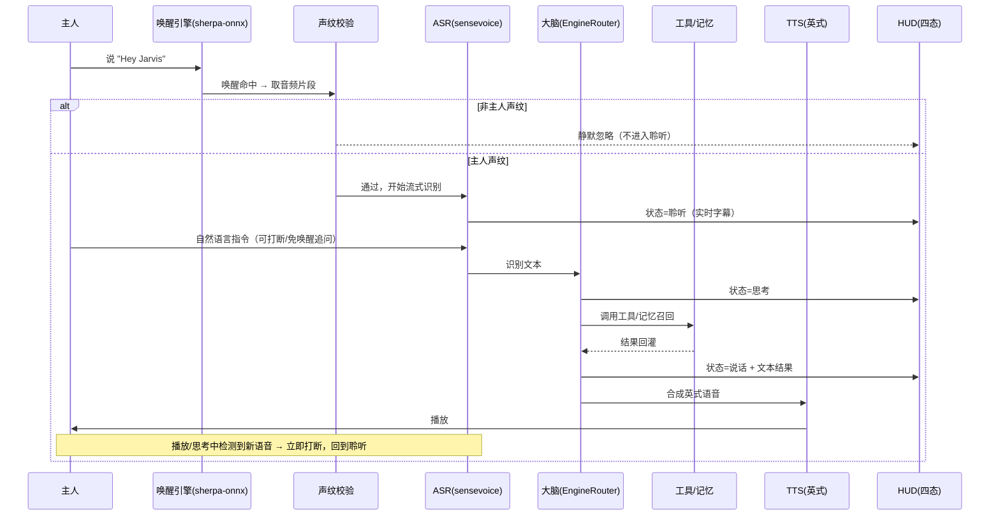

# 融合版 JARVIS v1 · 简单 PRD（产品需求文档）

> 文档负责人：产品经理「许清楚（Xu）」　|　版本：v1.0　|　语言：简体中文
> 依托现状：已阅读本地仓库 `jarvis_console/`（PySide6 总控台）与 `jarvis/`（唤醒/ASR 骨架）。
> 本文为 **简单 PRD**，聚焦目标、场景、用户故事、需求池、UI 要点、融合边界与待确认问题。

---

## 0. 背景与已对齐规格（直接采用，不重复论证）

用户要在已有的 Windows 桌面 AI Agent `jarvis_console`（代号"小王老师总控台"）基础上，融合开源项目 `GDDXX-Jarvis`（GitHub: `shitoudaidi/GDDXX-Jarvis`，GPL-3.0）的核心能力，做一个**本地优先、和原版体验一致的钢铁侠贾维斯语音助手**。已对齐 6 项决策：

1. **形态**：融合进现有 `jarvis_console`，不另起炉灶；复用其已跑通的大脑（DeepSeek + Ollama 兜底）、12 个工具、长期记忆、知识库沉淀。
2. **平台**：Windows 独占，双击 `.exe` 运行。
3. **语音**：v1 就要完整语音——本地离线 "Hey Jarvis" 唤醒 + 实时 ASR（接已有 sensevoice 路径）+ 声纹注册（只回应主人）；接话可打断、追问免唤醒。
4. **功能全选**：全息 HUD 主界面 + 8 套跟随"听/想/说"变化的皮肤；3D 全息演示（机器拆解/星舰发射回收/Roadster 悬停/Optimus 行走，手势可旋转拆装）；日程提醒 + 系统状态（CPU/内存/网络/电量实时上 HUD）；插件（米家设备控制、高德天气+路线、抖音创作者数据）；"学会新能力"（大脑写新技能→主人确认→装本地）。
5. **大脑**：多服务商切换 UI（DeepSeek/通义/Kimi/智谱/OpenAI/Ollama），默认 DeepSeek（沿用已配 Key）。
6. **交付**：打包成 Windows `.exe` 安装包，首次启动引导下载约 1GB 语音模型。

### 3 个假设 / 风险（用户已知会，需在 PRD 中固化）

| # | 风险项 | 处理原则 |
|---|--------|----------|
| R1 | **英式管家嗓音**：原版用社区 Piper 电影原声模型（仅个人非商业、不可再分发）。v1 改用可合法分发的英式 Piper 嗓音或 `edge-tts en-GB` 兜底，音质接近但**非电影原声**。 | 默认 `edge-tts en-GB`；若可获取合规英式 Piper 则优先。TTS 后端做成可插拔。 |
| R2 | **插件凭据**：米家/高德/抖音需用户自备账号或 API Key；无凭据时插件默认关闭、**不报错、不阻塞主链路**。 | 所有插件凭据缺失即优雅降级为"未启用"，UI 给出开关状态。 |
| R3 | **协议**：衍生自 GPL-3.0 项目，融合产物同样受 GPL-3.0 约束（个人使用无碍；对外分发需开源改动）。 | 全仓库沿用 GPL-3.0；闭源前需法律确认或剥离上游代码。 |

---

## 1. 产品目标（Product Goals，3 个清晰正交目标）

| 编号 | 目标 | 衡量标准（可验收） |
|------|------|--------------------|
| G1 | **本地优先的语音贾维斯闭环**：离线唤醒→声纹校验→实时 ASR→大脑→TTS→HUD，全程不依赖云端也可跑通（Ollama 兜底）。 | 断网状态下，"Hey Jarvis + 一句话指令"可完成至少 3 类已注册工具调用并语音+界面返回。 |
| G2 | **和原版一致的沉浸体验**：全息 HUD + 四态皮肤 + 3D 演示 + 系统/日程状态常驻。 | 唤醒/聆听/思考/说话四态可视觉区分；HUD 常驻 CPU/内存/网络/电量；4 个 3D 演示可手势旋转拆装。 |
| G3 | **可生长的能力平台**：多服务商大脑 + 插件 + "学会新能力"，能力边界随用户授权扩展。 | 大脑可在 6 个服务商间切换并保持工具调用一致；3 个插件凭据齐备后可用；能完成一次"写技能→确认→本地生效"闭环。 |

---

## 2. 目标用户与场景

| 用户 | 画像 | 典型场景 |
|------|------|----------|
| 主人（唯一授权者） | 个人开发者/极客，已在使用 `jarvis_console` 文字版，PC 常驻 Windows。 | 双手占用时口述指令；离线环境仍要可用；希望桌面有个"会说话的贾维斯"。 |
| 家庭/桌面旁观者 | 同处一室的人 | 说 "Hey Jarvis" 但**不被响应**（声纹拦截）；仅主人触发。 |
| 进阶玩家 | 想接米家/高德/抖音、自定义技能 | 提供 Key 后启用插件；让贾维斯"学会"一个脚本化能力。 |

---

## 3. 用户故事（按角色 / 场景）

| 编号 | 角色 | 故事 | 价值 |
|------|------|------|------|
| US-1 | 主人 | 作为主人，我说 "Hey Jarvis，帮我查下明天天气并提醒我 9 点开会"，以便**免手操作**完成日程+信息获取。 | 解放双手，信息主动上屏+播报。 |
| US-2 | 主人 | 作为主人，我在贾维斯播报途中直接插话追问"改成室内场馆"，以便**打断并连续对话**不被唤醒词打断。 | 自然对话流，不被打断流程。 |
| US-3 | 旁观者 | 作为同屋的人，我说 "Hey Jarvis" 时，希望它**不响应**，以免误操作主人设备。 | 隐私与安全。 |
| US-4 | 主人 | 作为主人，我希望 HUD 实时显示 CPU/内存/网络/电量，以便一眼掌握电脑状态。 | 常驻态势感知。 |
| US-5 | 进阶玩家 | 作为玩家，我填入高德 Key 后让贾维斯报天气+路线，未填时它安静不可用。 | 凭据驱动、优雅降级。 |
| US-6 | 主人 | 作为主人，我希望告诉贾维斯"学会每天早上拉一次 GitHub 星标"，它写好技能后**等我确认**再装上。 | 能力可自我生长，且有人把关。 |
| US-7 | 主人 | 作为主人，我断网时仍能"Hey Jarvis 打开记事本/关掉浏览器"，走本地 Ollama。 | 离线可用性。 |

---

## 4. 需求池（Requirements Pool）

> 优先级：**P0 = 主链路必做**；**P1 = 重要**；**P2 = 后续**。
> 每条含：编号 / 描述 / 验收标准。代码库现状已标注便于架构师对接。

### 4.1 P0 — 主链路必做

| 编号 | 描述 | 验收标准（AC） | 现状 / 扩展点 |
|------|------|----------------|---------------|
| **JV-P0-01** | **离线唤醒 "Hey Jarvis"**：本地唤醒引擎常驻监听，命中唤醒词进入聆听态。 | ① 双击 .exe 后无网络也能唤醒；② 误唤醒率 ≤ 可接受阈值（默认敏感度可调）；③ 复用 `jarvis/config.py` 的 `WAKE_MODEL` 路径约定；④ 遵守既有约束：sherpa-onnx 严格锁定 `1.12.40`，加载前 `chdir` 到模型目录、只传纯文件名、finally 恢复 cwd（避免中文路径 exit 127）。 | 现状：`speech/asr.py` 仅为 stub；`jarvis/config.py` 已定义 `WAKE_MODEL`。需新增 `speech/wake.py`。 |
| **JV-P0-02** | **实时 ASR（sensevoice 路径）**：唤醒后流式识别主人语音为文本，接话可打断、追问免唤醒。 | ① 复用 sensevoice 模型路径（`jarvis/config.py` `ASR_MODEL`）；② 流式字幕实时上 HUD（聆听态）；③ 支持打断：新语音能量超过阈值即中止当前 TTS/思考并重新识别；④ 同一轮对话内追问无需再说唤醒词。 | 现状：ASR 完全未实现。必须新建，且沿用 P0-01 的中文路径加载规则。 |
| **JV-P0-03** | **声纹注册与主人校验**：首次引导注册主人声纹；仅主人唤醒后才会真正执行指令，非主人唤醒被静默忽略。 | ① 首启引导完成 ≥1 段声纹注册；② 非主人说 "Hey Jarvis" 时不进入聆听/不执行、不报错；③ 可重新注册/清空声纹；④ 可在设置中关闭声纹（降级为"任意人说唤醒词即响应"，需明确提示风险）。 | 现状：无。需新增 `speech/voiceprint.py` + 注册引导 UI。 |
| **JV-P0-04** | **大脑多服务商切换 UI**：在 DeepSeek/通义/Kimi/智谱/OpenAI/Ollama 间切换，默认 DeepSeek（沿用已配 Key），失败按策略降级。 | ① UI 提供服务商选择器（含"默认/自动"）；② 默认 DeepSeek，云端不可达时自动切 Ollama；③ 各服务商 Key 经 `~/.jarvis/.env` 读取，UI/日志**只显示是否配置，绝不回显**；④ 切换后工具调用（OpenAI 兼容）行为一致。 | 现状：`core/llm_client.py` 仅 `DeepSeekClient`+`OllamaClient`+`MockLLMClient`，`EngineRouter` 仅"主+兜"两引擎。需扩展为 N 路、加 4 个云端客户端（或统一 OpenAI 兼容封装）。`config.py`/`console.yaml` 需增加 `providers` 段。 |
| **JV-P0-05** | **英式管家 TTS**：替换当前中文 `zh-CN-YunjianNeural` 播报，默认 `edge-tts en-GB`，可插拔 Piper 英式嗓音兜底（见 R1）。 | ① 默认英式嗓音播报；② 长文仍走摘要（复用 `prepare_speech_text` 的阈值/摘要逻辑）；③ TTS 后端可插拔（edge-tts / Piper）；④ 播报失败仅提示、不阻断主链路。 | 现状：`speech/tts.py` 仅 edge-tts 中文；`TTSWorker` 已存在。需扩展 voice 参数与可插拔后端。 |
| **JV-P0-06** | **HUD 主界面 + 四态**：全息风格主界面，随"唤醒/聆听/思考/说话"切换视觉状态与文案。 | ① 四态可清晰视觉区分（颜色/动效/字幕）；② 对话文本与过程结果在 HUD 可见；③ 保留现有控制台能力（工具过程、知识库沉淀、撤回）可作为 HUD 内子面板或可唤出。 | 现状：`ui/main_window.py` 是 ChatView+TraceView 分栏 + `DARK_QSS`。需新增 `ui/hud.py`，把现有面板作为"控制台"层级叠加/可切换。 |
| **JV-P0-07** | **融合进 `jarvis_console`**：复用现有大脑、12 个工具、`~/.jarvis/memory.db` 长期记忆、知识库沉淀、写入白名单安全门。 | ① 不另起新进程/新仓库；② 现有 12 工具、记忆召回、知识库 `ingest_note`/撤回、写入安全门全部保留可用；③ 新增语音链路只作为新的输入/输出通道接入 `AgentWorker`。 | 现状：`tools/__init__.py` 注册 12 工具；`AgentLoop`/`AgentWorker` 已就绪；`core/safety.py` 写入白名单（`KNOWLEDGE_DIR`、桌面、`PACKAGE_ROOT`、手动授权）。语音链路通过现有 worker 信号（sig_token/sig_tool_*）驱动 HUD。 |
| **JV-P0-08** | **.exe 打包 + 首次模型下载**：PyInstaller 打包为 Windows 安装包；首启引导下载约 1GB 语音模型（唤醒+sensevoice ASR+英式 Piper），支持断点续下。 | ① 双击 .exe 即可启动；② 首启检测本地模型缺失→引导下载（进度可见、可取消、可续传）；③ 缺模型时给出明确指引而非崩溃；④ 安装包不含模型权重（合规/R1 与体积）。 | 现状：仅源码 + `.venv`。需新增构建脚本 + 安装器（NSIS/Inno Setup）+ 模型下载器。注意 `sherpa-onnx` 锁定 `1.12.40`、`edge-tts==7.3.1` 须随包固定。 |
| **JV-P0-09** | **打断与免唤醒追问（barge-in）**：播放/思考中可被新语音打断；同一对话内追问无需唤醒词。 | ① 播放中检测新语音→立即停 TTS→转聆听；② 一轮对话内多次追问免唤醒；③ 超时（如 8s 静音）自动回到待命态。 | 现状：无语音输入，无打断。需在 ASR/音频调度层实现能量检测与状态机。 |

### 4.2 P1 — 重要

| 编号 | 描述 | 验收标准（AC） | 现状 / 扩展点 |
|------|------|----------------|---------------|
| **JV-P1-01** | **HUD 实时系统状态**：CPU/内存/网络/电量实时上 HUD。 | ① 每秒级刷新（CPU/内存/网络吞吐/电量）；② 网络/电量来源本地 API（无网络亦可显示）；③ 异常（掉线/低电量）有提示态。 | 现状：`tools/systemtools.py` 的 `system_status` 仅 CPU/内存/磁盘。需补**网络**与**电量**，并新增 HUD 轮询 Worker。 |
| **JV-P1-02** | **日程提醒**：设定提醒（时间/内容），到点主动语音+HUD 提醒。 | ① 支持"N 分钟后/今天 HH:MM/每天 HH:MM"；② 到点触发 TTS+HUD 弹层；③ 可查看/取消提醒。 | 现状：无。需新增 `tools/schedule.py` + 后台定时器 + HUD 提醒层。 |
| **JV-P1-03** | **插件：米家设备控制** | ① 凭据齐备后可"打开客厅灯/查温湿度"等；② 凭据缺失→默认禁用、UI 显示"未启用"、不报错；③ 危险操作（开关）有确认门。 | 现状：无。新增 `tools/mijia.py`，凭据从 `~/.jarvis/.env` 读取；遵循 R2。 |
| **JV-P1-04** | **插件：高德天气 + 路线** | ① Key 齐备后"报天气/规划从 A 到 B 路线"；② 缺失→禁用不报错；③ 返回结构含来源。 | 现状：无。新增 `tools/amap.py`，R2 同。 |
| **JV-P1-05** | **插件：抖音创作者数据** | ① 凭据齐备后拉取"我的作品/播放/涨粉"等；② 缺失→禁用；③ 不复用旧 `douyin_tool.py` 的本地视频 ASR 思路（stub），走创作者开放接口。 | 现状：`tools/douyin_tool.py` 仅为 stub（`douyin_asr_status` 未注册）。新增 `tools/douyin_creator.py`，R2 同。 |
| **JV-P1-06** | **"学会新能力"闭环**：大脑生成新技能代码→主人确认→写入白名单内 skills 目录→本地注册生效。 | ① 用户提出"学会 XX"→大脑产出符合 `@tool` 装饰器约定的 `.py`；② 先弹窗展示代码+影响范围，主人确认后才写；③ 写入位置必须在 `PathPolicy` 允许根内（建议 `jarvis_console/skills/`= `PACKAGE_ROOT`）；④ 写入后动态 import 并注册进 `REGISTRY`，本轮或重启后可用；⑤ 拒绝写入白名单外/含危险调用的技能。 | 现状：`core/tool_registry.py` 的 `@tool` 注册器、安全写入门（`write_file`/`PathPolicy`）齐备，可直接复用。需新增技能生成意图识别 + 受控写入/加载器。 |
| **JV-P1-07** | **8 套皮肤（听/想/说 跟随变化）** | ① ≥8 套主题；② 至少聆听/思考/说话三态自动切换对应皮肤动效；③ 可在设置中手动选皮肤。 | 现状：`ui/theme.py` 仅 `DARK_QSS`。需抽象"皮肤包"结构（QSS + 动效资源），四态驱动切换。 |
| **JV-P1-08** | **3D 全息演示**（机器拆解/星舰发射回收/Roadster 悬停/Optimu 行走，手势可旋转拆装） | ① 4 个演示场景可唤起；② 鼠标/触控手势可旋转、缩放、拆解/装配部件；③ 帧率流畅（建议 ≥30fps）；④ 资源体积可控，随包或首启下载。 | 现状：无。建议 `QWebEngineView + three.js`（手势/旋转实现成本低、风险小），或 Qt3D。具体选型列为 Open Question。 |

### 4.3 P2 — 后续

| 编号 | 描述 | 备注 |
|------|------|------|
| JV-P2-01 | 多主人 / 多声纹 | 家庭多成员授权。 |
| JV-P2-02 | 记忆/技能跨设备云同步 | 需账户体系，受 R3 与隐私约束。 |
| JV-P2-03 | 3D 演示场景扩展 | 更多拆解/发射动画。 |
| JV-P2-04 | 插件市场 / 技能商店 | 社区共享技能，需签名与审核。 |
| JV-P2-05 | 自定义唤醒词 | 替换默认 "Hey Jarvis"。 |
| JV-P2-06 | 全离线 LLM 默认链路 | Ollama 本地模型默认，彻底去云端依赖。 |

---

## 5. UI 设计稿要点

### 5.1 HUD 总体布局

```
┌───────────────────────────────────────────────────────────┐
│  [引擎徽标 DeepSeek/Ollama/…]   [系统状态: CPU/内存/网络/电量]│  ← 常驻顶栏
├───────────────────────────────────────────────────────────┤
│                                                             │
│             ● 全息圆环 / 贾维斯头像（中心点）                │
│            （四态动效：待命蓝 / 聆听青 / 思考紫 / 说话金）   │
│                                                             │
│           实时字幕 / 思考转写（居中浮现）                   │
│                                                             │
├───────────────────────────────────────────────────────────┤
│  [3D 演示区]            [控制台子面板（可收起）]            │  ← 分栏
│   机器/星舰/Roadster/Optimu  工具过程 / 知识库沉淀 / 撤回    │
├───────────────────────────────────────────────────────────┤
│  [Hey Jarvis 待命]  [麦克风/打断指示]  [设置/服务商/皮肤]   │  ← 底栏
└───────────────────────────────────────────────────────────┘
```

- **风格**：玻璃拟态 / 全息蓝青色调，半透明常驻，可置顶或嵌入桌面。
- **现有资产复用**：`EngineBadges`、`MemoryIndicator`、`IngestBanner`、`TraceView`、`ChatView` 改造为上述"顶栏/控制台子面板"，而非推翻重写。

### 5.2 四态状态机

| 状态 | 触发 | 视觉 | HUD 行为 |
|------|------|------|----------|
| **待命 (Idle)** | 启动 / 对话结束超时 | 蓝色稳定环 | 仅显示常驻系统状态；麦克风监听唤醒词。 |
| **聆听 (Listening)** | 唤醒词命中 + 声纹通过 | 青色脉冲环 + 波形 | 实时 ASR 字幕上屏；能量超阈值可打断。 |
| **思考 (Thinking)** | 文本送入大脑 | 紫色旋流 | 显示"正在思考"，保留字幕；可被打断。 |
| **说话 (Speaking)** | 大脑返回结果 | 金色扩散环 | TTS 播报 + 文本上屏；播放中可被新语音打断（barge-in）。 |

> 状态由统一状态机驱动，皮肤（JV-P1-07）根据状态自动切换；同一状态下不同皮肤仅改配色/动效，不改布局。

### 5.3 关键交互

- **唤醒→执行** 全程无需点击（声纹通过即执行，破坏性操作仍走 `ConfirmationGate` 弹窗，沿用现有安全门）。
- **打断**：说话/思考态检测到新语音能量→立即停 TTS、置聆听态。
- **3D 演示**：独立手势层（旋转/缩放/拆装），不干扰语音主链路。
- **首启向导**：声纹注册 →（可选）插件 Key 录入 → 模型下载引导。

---

## 6. 与现有 `jarvis_console` 的融合边界说明

| 维度 | 复用（保留） | 新增 / 改造 | 融合边界原则 |
|------|--------------|-------------|--------------|
| **大脑** | `AgentLoop`、`EngineRouter`（主+兜）、`MemoryStore`、知识库 `ingest_note`/撤回、`message_builder` 防泄漏 | 扩展 `llm_client` 为 N 路多服务商（P0-04）；UI 服务商选择器 | 不重写推理循环，只替换/扩充客户端与路由。 |
| **工具** | `REGISTRY` + 现有 12 工具、`@tool` 装饰器、破坏性确认门、`PathPolicy` 写入白名单 | 插件（米家/高德/抖音 P1-03~05）、日程（P1-02）、技能装载（P1-06） | 新工具一律走 `@tool` 注册 + 凭据缺失即禁用的统一范式（R2）。 |
| **语音输入** | `jarvis/config.py` 的 `WAKE_MODEL`/`ASR_MODEL` 路径约定、sherpa-onnx 加载纪律 | 新建 `speech/wake.py`、`speech/asr.py`（替换 stub）、`speech/voiceprint.py` | 严格复用中文路径 `chdir` 加载规则，避免 exit 127。 |
| **语音输出** | `speech/tts.py` 的 `prepare_speech_text` 摘要逻辑、`TTSWorker` | 可插拔 TTS 后端（edge-tts en-GB / Piper 英式，P0-05，R1） | 摘要逻辑不动，只换嗓音与后端抽象。 |
| **UI** | `DARK_QSS`、`ChatView`/`TraceView`/`EngineBadges`/`IngestBanner` 等控件 | 新增 `ui/hud.py` 全息主界面、`ui/skins.py` 皮肤包、`ui/hologram.py` 3D 区 | 现有控件下沉为"控制台子面板"，HUD 为新增顶层容器。 |
| **安全** | `core/safety.py`（写入白名单、`read_denylist` 密钥拒读、`ConfirmationGate`） | "学会新能力"受控写入复用同一白名单（P1-06） | 任何新能力写入必须落在 `PathPolicy` 允许根内；绝不绕过白名单。 |
| **记忆/知识** | `~/.jarvis/memory.db`、知识库 `D:\Desktop\MyKnowledge\pipeline.db` | 无新增存储结构 | 沿用物理隔离，新增能力不新建数据库。 |
| **打包** | `.venv` 依赖版本纪律（sherpa-onnx 1.12.40 / edge-tts 7.3.1） | PyInstaller + 安装器 + 模型下载器（P0-08） | 依赖版本锁定须带入打包；模型权重不进包（R1/体积）。 |

> **上游 GDDXX-Jarvis 融合边界**：本 PRD 采用其**能力概念**（HUD/皮肤/3D/声纹/打断），但**实际源码与 3D 资源未在本地产线取到**（仅 GitHub 描述）。建议架构师在开工前拉取上游仓库，确认：① 3D 资源/渲染实现可合规复用（R3 GPL-3.0）；② HUD/四态的视觉与交互细节；③ 唤醒词/ASR 实现是否与本项目 sensevoice 路径一致。详见 Open Question Q6。

---

## 7. 主链路时序图（Mermaid）



---

## 8. 待确认问题清单（Open Questions）

| # | 问题 | 影响 | 建议 / 负责方 |
|---|------|------|----------------|
| Q1 | **TTS 语种 vs 内容语种**：大脑当前用中文回答（SYSTEM_PROMPT"用简洁中文"），但英式管家嗓音是英文音色。英文 TTS 读中文会带口音。是否①中文内容配英式 TTS（带口音）、②内容改英文、③仅关键短语用英文、④可切换？ | 语音体验核心 | 建议默认①+可切④；需用户拍板。PM 汇总。 |
| Q2 | **唤醒词引擎选型**："Hey Jarvis" 离线唤醒用哪套？Porcupine（需 Key/模型）、sherpa-onnx 关键词、或自训轻量模型？唤醒模型来源是否合规可分发（R1）？ | P0-01 | 优先找可合法分发的离线唤醒方案；架构师评估。 |
| Q3 | **声纹技术栈**：用哪个说话人验证库（如 `pyannote`/`resemblyzer`/自训练）？本地推理性能与误拒率？ | P0-03 | 需样机验证；性能敏感。 |
| Q4 | **3D 渲染选型**：`QWebEngineView + three.js` vs `Qt3D`？资源（模型/动画）如何获取与合规（R3）？ | P1-08 | 倾向 three.js（实现快、手势易）；待 Q6 上游确认。 |
| Q5 | **多服务商 Key 管理**：通义/Kimi/智谱/OpenAI 的 Base URL 与模型名默认值？是否提供"一键填入示例"？ | P0-04 | 在 `console.yaml` 增加 `providers` 默认段。 |
| Q6 | **GDDXX-Jarvis 上游对接**：是否拉取上游源码？HUD/皮肤/3D/声纹/打断的具体实现与资源能否合规复用（R3）？本项目 sensevoice 路径是否与其一致？ | 全局 | 开工前由架构师从 GitHub 取码评审，输出"可复用清单"。 |
| Q7 | **首启模型下载体积与源**：约 1GB 具体构成（唤醒+ASR+Piper 英式）？下载源托管（自有 CDN/对象存储）与断点续传方案？ | P0-08 | 需确定托管与校验（哈希）。 |
| Q8 | **"学会新能力"安全边界**：生成代码的沙箱/静态审查强度？是否限制可调用 API（如禁止网络写、限制文件写入白名单内）？ | P1-06 | 复用 `PathPolicy` + 静态黑名单；建议最低限度审查。 |
| Q9 | **HUD 与现有控制台的关系**：HUD 是取代还是叠加现有聊天窗口？老用户是否还能用文字输入？ | P0-06 | 建议叠加（HUD 为主、控制台可收起），文字输入保留。 |

---

## 9. 非目标（Out of Scope，v1 不做）

- 移动端 / macOS / Linux 支持（Windows 独占）。
- 云端多设备同步账户（P2）。
- 闭源商业化分发（受 R3 GPL-3.0 约束）。
- 电影原声级嗓音（受 R1 限制）。
- 超出白名单的任意代码执行（安全门不可绕过）。

---

*— 文档结束 —　产品经理：许清楚（Xu）　融合版 JARVIS v1 简单 PRD v1.0*
