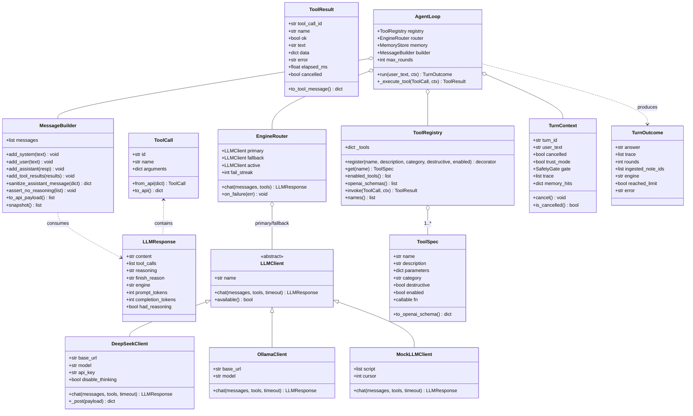
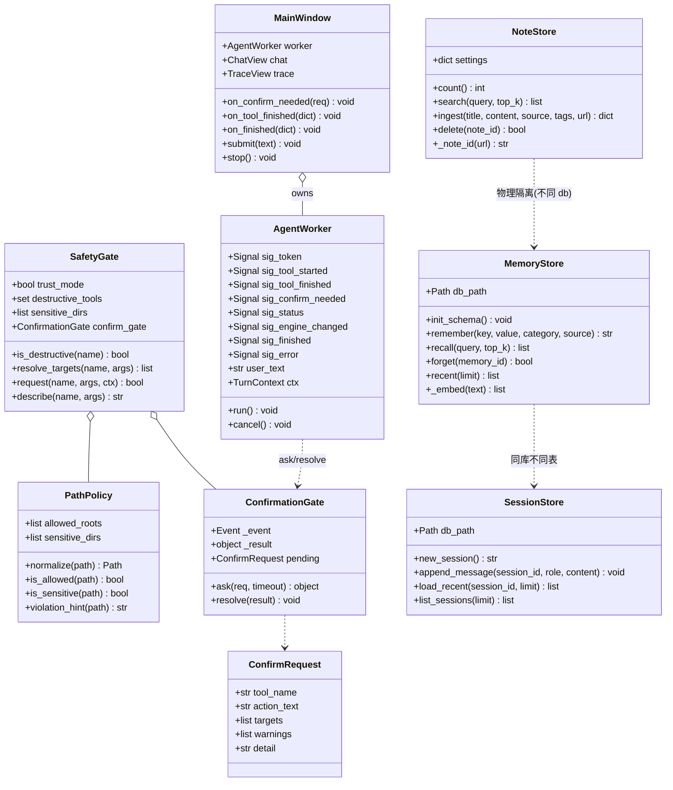
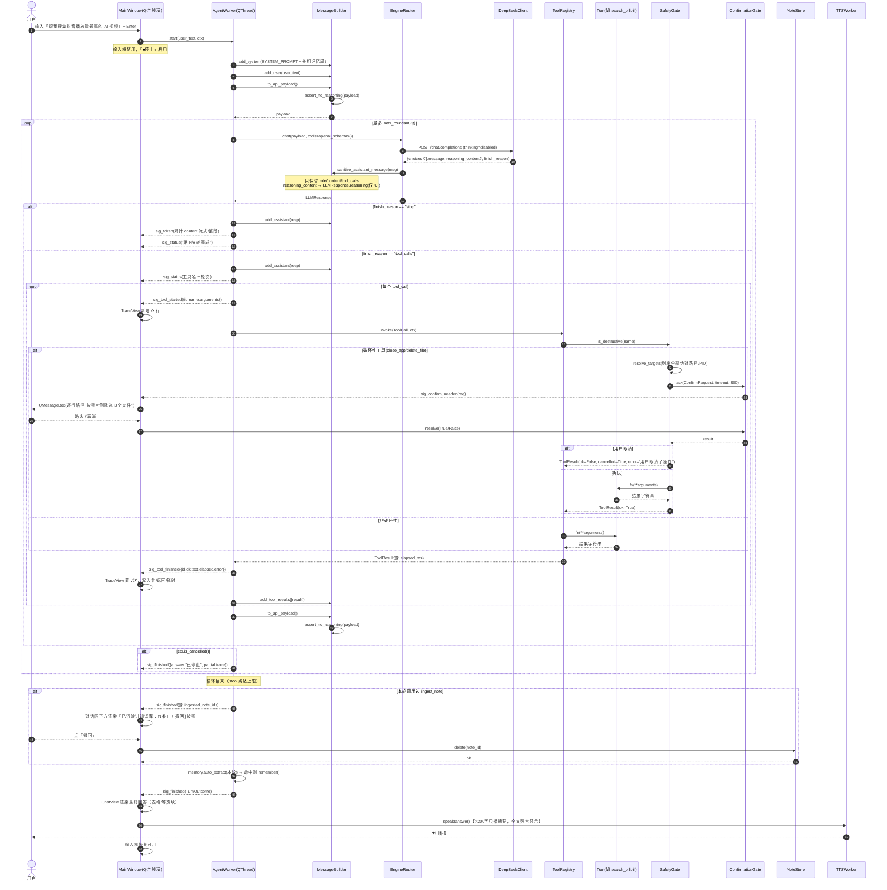
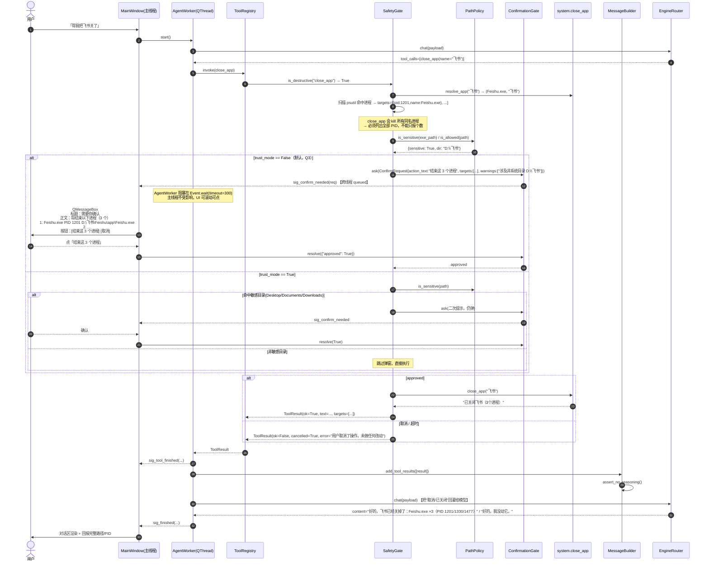
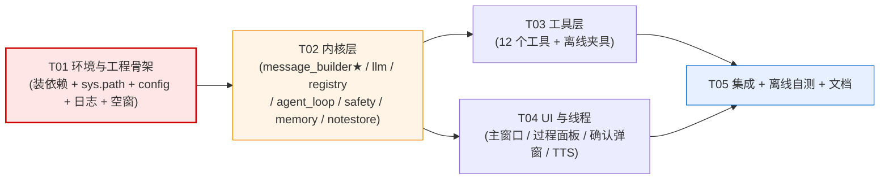

# 实现设计 —「小王老师」总控台（jarvis_console）

> 本文是 `docs/PRD-小王老师总控.md` 的实现层细化，供工程师照此写码。
> **§0 不可动摇基线一律继承，不重新论证、不推翻。**
> 读码复核结论以本文 §0.5 为准（与 PRD 附录 A 有出入处已标红）。
> 作者：高见远（架构师）｜2026-10-30｜状态：待拍板→可直接开工

---

## §0 输入复核结论（读码所得，本文的地基）

### 0.5 本轮亲自读码复核的结果（覆盖/修正 PRD 附录 A 与 §0.4）

| # | 复核结论 | 证据 | 与 PRD 差异 |
|---|---|---|---|
| ① | `core/pipeline.py::run_source` 第 **62 行** `if not scfg.get("enabled", False): return skipped` —— **`enabled` 门真实存在**，总控台必须绕开 | 逐行读 `pipeline/core/pipeline.py` | 一致，落为铁律 4 |
| ② | `WebCollector(cfg)` 只需 `cfg["seeds"]`，**不读 sources.yaml、不查 enabled**；`_fetch` 支持 `file://` 与本地路径（离线可测） | `pipeline/collectors/web.py:118-173` | 一致，可直接喂临时 seeds |
| ③ | `ingest_note(note: Note, settings=None) -> Note`，内部 `init_db()` **无参调用**→ 写死 `DEFAULT_DB = D:/Desktop/MyKnowledge/pipeline.db` | `pipeline/ingest/ingest.py:20-57` | ⚠️ **无法用参数改库**，回归测试必须用"临时库 + monkeypatch `core.db.DEFAULT_DB`"，见 §7.4 |
| ④ | `core/search.py::search(query, top_k, settings)` 返回 `dict(row)`（notes 表全字段）+ `score`，**已含 `content`/`raw_path`/`note_id`** | `pipeline/core/search.py:16-30` | 一致；因此 `read_file` 在 US-2 场景非必需，但仍保留（读任意文件） |
| ⑤ | `jarvis/skills/system.py` 七函数签名确认：`open_app/close_app/list_apps/find_files/system_status/screenshot/set_volume`，**全返回中文 str**；`close_app` 用 `psutil.terminate()`，会杀掉**所有同名进程** | 逐行读 | ⚠️ `close_app` 是"批量杀伤"，确认弹窗必须列出**全部命中 PID**，不能只报个数 |
| ⑥ | `jarvis/config.py::get_secret` 只读 `<repo>/.env`，**不看 `~/.jarvis/.env`**；`ROOT` 由 `abspath(__file__)` 两级上推得出 | `jarvis/config.py:8-39` | 需扩展，见 §5.4 |
| ⑦ | **`edge-tts 7.3.1 已装**、`psutil 7.2.2 已装`、`numpy 2.5.4 已装`、`requests 2.34.2 已装` | `.venv/Scripts/python.exe -m pip list`（本轮实测 31 个包） | ⚠️ **PRD §0.4-A 把 edge-tts 列入"缺失"是错的**，本轮实测它**在**。不要重复安装 |
| ⑧ | 仍缺失：`PyYAML` / `trafilatura` / `PySide6` / `pytest` / `openai` / `fastapi` / `uvicorn` / `chromadb` / `faster-whisper` / `cv2` | 同上 | 本版只需补前 4 个（见 §6） |
| ⑨ | `~/.jarvis` **目录当前不存在**；`D:\Desktop` 存在（桌面确在 D 盘） | `ls ~/.jarvis` / `ls -d /d/Desktop` | 启动须 `mkdir(parents=True, exist_ok=True)` |
| ⑩ | `jarvis/skills/__init__.py` 存在（空），`jarvis/__init__.py` 存在 → 从仓库根 `import jarvis.skills.system` 直接可用 | `ls` | 只需 `sys.path` 挂仓库根 |
| ⑪ | `pipeline/core/` **无 `__init__.py`**（命名空间包），靠 `sys.path.insert(pipeline根)` 才能 `import core.db` | `ls pipeline/core` | 铁律：`sys.path` 必须挂 **pipeline 根**，且**不得 chdir** |
| ⑫ | `core/models.py::Note` 字段齐全（`note_id/title/content/source/url/note_type/para/tags/links/summary/attachments/created_at/raw_path/embedding_id`）；`NoteType` / `ParaCategory` 是 `str, Enum` | 逐行读 | 入库时 `note_type` 建议 `LITERATURE`、`para` 建议 `RESOURCE` |
| ⑬ | `core/embedder.py::Embedder(base_url, model)` 走 Ollama `/api/embed`，失败降级 384 维哈希向量；`core/vectorstore.py::LocalStore` 零依赖回退 | 逐行读 | ⚠️ **降级向量与 bge-m3 的 1024 维不兼容**（历史踩过维度冲突），离线测试若混用会 ValueError → 见 §7.4 隔离策略 |

---

## §1 实现方案与框架选型

### 1.1 为什么选 PySide6 而不是 PyQt6

| 维度 | PySide6（选它） | PyQt6（不选） |
|---|---|---|
| 许可 | **LGPL v3**，Qt 官方（The Qt Company）出品，可闭源自用，动态链接即可 | GPL v3 或商业授权；GPL 具有传染性，与"私人助理但未来可能商业化"冲突 |
| 维护 | Qt 官方同步发版，与 Qt C++ 版本一一对应 | Riverbank 第三方，发版滞后于 Qt |
| 类型/工具链 | 官方 `shiboken6` 生成，`.pyi` 类型提示完整 | 自带 sip，类型提示质量参差 |
| 槽/信号 | `Signal` / `Slot` 语义与 Qt C++ 完全一致 | 同，但 `@pyqtSlot` 装饰器细节差异多 |

**结论**：PRD §0.1 已定，LGPL 是决定性理由。装 `PySide6` 时用 `pip install PySide6`（官方 wheel 自带 Qt 运行时，体积 ~200MB，需 `--timeout 15 --no-cache-dir` 且**放在最后装**，见 §6.3）。

### 1.2 整体架构：分层 + 单向依赖

```
┌─────────────────────────────────────────────────────────────┐
│ UI 层（Qt 主线程，唯一允许碰 Widget 的地方）                  │
│  ui/main_window · chat_view · trace_view · confirm_dialog     │
└───────────────▲─────────────────────────────────────────────┘
                │ Signal（queued，跨线程安全）   ▲ ConfirmationGate.resolve
┌───────────────┴─────────────────────────────────────────────┐
│ Workers 层（QThread，跑在 UI 之外）                           │
│  workers/agent_worker（= 一次完整 Turn）· tts_worker          │
└───────────────▲─────────────────────────────────────────────┘
                │ 直接函数调用（同线程，同步阻塞）
┌───────────────┴─────────────────────────────────────────────┐
│ 内核层（纯 Python，零 Qt 依赖，可单测）                        │
│  core/agent_loop · llm_client · message_builder              │
│  core/tool_registry · safety · memory · notestore · metrics   │
└───────────────▲─────────────────────────────────────────────┘
                │
┌───────────────┴─────────────────────────────────────────────┐
│ 工具层（tools/*，被内核按名调用）                              │
│  → 复用 pipeline（core.search / ingest / collectors.web）     │
│  → 复用 jarvis.skills.system                                  │
│  → 新写 bilibili 搜索 / 网页搜索 / 文件 IO / 记忆             │
└─────────────────────────────────────────────────────────────┘
```

**三条硬边界（违反即翻车）**
1. **内核层与工具层不得 import 任何 `PySide6`**。它们必须能在无 GUI 的 pytest 里裸跑（这是"离线自测"可行的前提）。
2. **UI 层不得直接调用工具或 LLM**，只能发 Signal 给 worker、收 Signal 刷界面。
3. **工具层不得 import `core.agent_loop`**（防环），工具只依赖 `core.errors` / `core.types`。

### 1.3 线程边界（铁律 1 的落地）

| 线程 | 允许干 | 禁止干 |
|---|---|---|
| **Qt 主线程** | 渲染 Widget、弹 QMessageBox、更新 QTreeWidget、连接 Signal | 任何 HTTP、任何 LLM、任何 sqlite 写、任何 `subprocess`、任何 `time.sleep` |
| **AgentWorker（QThread）** | 跑 `agent_loop` 全循环（LLM 请求 + 工具执行 + sqlite 读写）、阻塞等确认 | 直接 `setText` / 弹窗（一律发 Signal） |
| **TTSWorker（QThread）** | `edge-tts` 合成 + `pygame/playsound` 播放；本设计用 `edge_tts.Communicate.stream()` + `subprocess` 调 PowerShell 播放 | 同上 |
| **QThreadPool（可选）** | 单工具内部并发（如 `fetch_page` 抓 10 个页面） | 碰 Widget |

**信号命名约定**（全局统一，见 §7.6）：所有 Signal 属性以 `sig_` 开头，`Signal(...)` 只传**可 pickle 的基础类型**（`str` / `int` / `float` / `dict` / `list` / `object`），**绝不传 Qt Widget 或自定义对象跨线程**（用 dict 序列化）。

**确认门的线程握手**（铁律 1 + 门禁 铁律 9 的交叉点）：

```
AgentWorker(子线程)                          Qt 主线程
─────────────────────────                   ─────────────────────────
gate = ConfirmationGate()
...
result = gate.ask(req)          ──emit sig_confirm_needed(dict)──▶  slot: 弹 QMessageBox(模态)
   │  (threading.Event.wait())                                        │ 用户点"删除这 3 个文件"
   │◀─────────────── gate.resolve(True) ── Event.set() ───────────────┘
   ▼
继续执行 / 抛 UserCancelledError
```

- `gate.ask()` 用 `threading.Event.wait(timeout=300)`（5 分钟超时视为取消，防止主线程崩了 worker 永久挂起）。
- **弹窗必须列出完整绝对路径/PID**，`QMessageBox.buttonText` 写具体动作（"删除这 3 个文件"），不用"确定/取消"。
- 用户取消 → 工具返回 `ToolResult(ok=False, error="用户取消了操作")` **回灌给模型**，让小王老师自己说"好的，我没动它"。**不是抛异常终止整轮**。

### 1.4 `reasoning_content` 处理策略（铁律 2 的落地）

三层防御，缺一不可：

| 层 | 位置 | 做法 |
|---|---|---|
| **L1 请求侧（尽力关）** | `core/llm_client.py` | 请求体带 `extra_body={"thinking": {"type": "disabled"}}`（配置开关 `llm.disable_thinking: true`）。**若 API 报 unknown param，把开关置 false 即可，不影响其它层** |
| **L2 响应侧（白名单剥离）** | `core/message_builder.py::sanitize_assistant_message()` | 从 `response["choices"][0]["message"]` **只取** `role` / `content` / `tool_calls` 三个键重建 dict，`reasoning_content` 天然丢弃。另把剥离出的思考文本单独塞进 `LLMResponse.reasoning`（供 UI「思考」折叠区展示，**不参与协议往返**） |
| **L3 出口侧（兜底断言）** | `core/message_builder.py::to_api_payload()` | 每次 POST 前递归扫描 messages：`assert_no_reasoning(messages)`，命中即 `raise ReasoningLeakError` 并记 ERROR 日志（**阻断而非静默**，静默是最坏结果） |

**单元测试要求**（`tests/test_message_builder.py`）：
- `test_three_round_tool_calls_no_reasoning`：构造 3 轮含 tool_calls 的多轮 messages，逐个 append 后 `to_api_payload()`，**递归断言整个 payload 里没有 `reasoning_content` 键**。
- `test_reasoning_preserved_for_ui`：断言 `LLMResponse.reasoning` 有值，但 payload 无。
- `test_reasoning_leak_raises`：手工塞入脏字段，断言抛 `ReasoningLeakError`。

### 1.5 首批工具清单（铁律 3）：**12 个**

> 归类原则：**同一类"动作"只留一个入口**（合并同类项），**按"用户会怎么说"而不是"代码里有什么函数"划分**，破坏性工具单独成类并标 `destructive=True`。

| # | 工具名 | 归类 | 来源 | 破坏性 | 一句话职责 |
|---|---|---|---|---|---|
| 1 | `search_bilibili(keyword, order="click", limit=10)` | 采集 | 【新写】B站官方搜索接口 | ✗ | 按关键词搜视频，**返回真实播放量**，按 `click`(播放)/`pubdate`(最新)/`dm`(弹幕)/`stow`(收藏) 排序 |
| 2 | `web_search(query, limit=5)` | 采集 | 【新写】DDG→Bing HTML 解析 | ✗ | 通用网页关键词搜索，零 Key；失败返回 `ok:false` + 原因，让模型如实说明 |
| 3 | `fetch_page(url, max_chars=6000)` | 采集 | 【复用】`WebCollector({"seeds":[url]})` | ✗ | 抓指定 URL 正文（**绕过 `enabled` 门**） |
| 4 | `knowledge_search(query, top_k=5)` | 知识库 | 【复用】`core.search.search` | ✗ | 语义检索 MyKnowledge，返回 标题/摘要/相似度/note_id/raw_path |
| 5 | `ingest_note(title, content, source="jarvis_console", tags=[], url="")` | 知识库 | 【薄封装】`Note` + `ingest_note` | ✗ | 写一条原子笔记进 MyKnowledge（md + bge-m3 向量 + SQLite） |
| 6 | `system_status()` | 本机 | 【薄封装】`system.system_status` | ✗ | CPU/内存/磁盘快照 |
| 7 | `list_processes(limit=25)` | 本机 | 【薄封装】`system.list_apps` | ✗ | 列出正在运行的程序（名 + PID） |
| 8 | `close_app(name)` | 本机 | 【薄封装+门禁】`system.close_app` | **✓** | 关闭应用/结束进程；**弹窗列出全部命中 PID** |
| 9 | `find_files(pattern, root=None, limit=12)` | 文件 | 【薄封装】`system.find_files` | ✗ | 模糊找文件；`pattern="*"` 等价列目录（**合并了 list_dir**） |
| 10 | `read_file(path, max_chars=8000)` | 文件 | 【新写】 | ✗ | 读 md/文本；越白名单报错 |
| 11 | `write_file(path, content, overwrite=True)` | 文件 | 【新写】 | ✗ | 写文件，**回报完整绝对路径 + 行数** |
| 12 | `delete_file(path)` | 文件 | 【新写+门禁】 | **✓** | 删除单个文件；**弹窗列出完整绝对路径** |

**不在首批（有意为之，释放工具槽）**

| 能力 | 去向 | 理由 |
|---|---|---|
| `speak(text)` | **改成回合结束自动播报**（`speech/tts.py`），不是工具 | ① 少占一个槽；② Q6 要求"超 200 字只播摘要"——这活儿由 console 确定性做，比让模型判断可靠；③ 保证每条都播，不会漏。**这是对 PRD §3 P0-2.9 的有意偏离，需拍板（见 §9-7）** |
| `remember(key,value)` / `recall(query)` | **改成自动注入 + 自动提取**（`core/memory.py`），不是工具 | ① US-5 的"隔天重开还说老规矩"依赖**每轮必召回**，靠模型记得调 `recall` 会漏；② 右上角"记忆指示灯"要求 console 自己知道用了哪几条；③ 省 2 个槽。**需拍板（见 §9-8）** |
| `open_app` / `screenshot` / `set_volume` | 注册表已留位，`console.yaml` 默认 `enabled: false` | 第二批动态装载（P2-3） |
| `move_file` / `rename_file` | 同上 | P1-4 |
| `douyin_asr`（本地视频转写） | `tools/douyin_tool.py` 桩 + 配置开关 `tools.douyin_asr.enabled: false` | **Q5 已拍板：本版不装 faster-whisper、不下 GB 权重** |
| `tavily_search` / `brave_search` | `tools/web_search.py` 内留 `TavilyProvider` 接口位，`search.provider: "ddg"` | **Q4 已拍板：付费 API 只留位，本版不接** |

### 1.6 复用 pipeline 的正确姿势（铁律 4）

```
❌ 禁用：core.pipeline.run_source("web")        # 第 62 行 enabled 门会静默跳过
✅ 正解：
   from collectors.web import WebCollector
   items = WebCollector({"seeds": [url], "timeout": 20, "verify_ssl": True}).collect()
   → RawItem(url, title, content, source, keywords)
```
入库同理：**不走** `core.pipeline`，直接 `from ingest.ingest import ingest_note` + `from core.models import Note`，自己拼 `note_id`（`hashlib.md5(url)[:10]` 或 `uuid4()` 前 10 位）。

### 1.7 离线可测性（铁律 6）——Mock LLM 模式

沙箱出网有 MITM 代理（requests 默认 `CERTIFICATE_VERIFY_FAILED`），GitHub Releases 下不动 → **所有联网验证留给用户本机**。因此设计强制提供：

1. **`MockLLMClient`**：读 `jarvis_console/fixtures/mock_script.json`，按脚本**按序**返回 assistant 消息（含 `tool_calls`），可完整驱动"LLM → 工具 → 回灌 → 再 LLM"的闭环。启用方式：环境变量 `JARVIS_MOCK=1` 或 `console.yaml` 的 `llm.mode: "mock"`（**环境变量优先**）。
2. **网络夹具**：`fixtures/bilibili_search_sample.json`、`fixtures/page_sample.html`，让 `search_bilibili` / `fetch_page` 在 `JARVIS_MOCK=1` 下直接读夹具返回，不发一个包。
3. **临时库隔离**：所有测试强制走 `tmp_path`，并 monkeypatch `core.db.DEFAULT_DB`（见 §7.4）——历史已栽过一次（M4 污染真实库）。

---

## §2 完整文件清单

> 顶层目录 `jarvis_console/`，与既有 `pipeline/`、`jarvis/` **平级**，两边只"读调用"不"改源码"。

```
D:/workbuddy worktool/贾维斯/
├── pipeline/                              # 【既有，不改】
├── jarvis/                                # 【既有，不改】(config.py 仅被参考，不修改)
└── jarvis_console/                        # 【本版新增】
    ├── __init__.py                        # 包标记 + 版本号
    ├── __main__.py                        # 入口：python -m jarvis_console（引导 sys.path 后起 App）
    ├── app.py                             # QApplication 组装：加载配置→建窗→接信号→exec()
    ├── paths.py                           # sys.path 引导（挂仓库根 + pipeline根）+ 关键目录常量
    ├── config.py                          # ConsoleConfig 加载 + get_secret 三级密钥链 + 脱敏
    ├── logging_setup.py                   # 统一日志入口（Key 脱敏、文件+队列、ERROR 单独留痕）
    │
    ├── config/
    │   └── console.yaml                   # jarvis_console 自身配置：llm/tools/safety/memory/ui
    │
    ├── core/                              # 内核层（零 Qt 依赖，可裸跑单测）
    │   ├── __init__.py
    │   ├── types.py                       # ToolCall/ToolResult/LLMResponse/TurnContext/ConfirmRequest 数据类
    │   ├── errors.py                      # 统一错误类型（JarvisError 树）
    │   ├── message_builder.py             # messages 组装 + reasoning_content 三层防御（★核心）
    │   ├── llm_client.py                  # LLMClient 协议 + DeepSeek/Ollama/Mock 三实现 + 双引擎降级
    │   ├── tool_registry.py               # @tool 装饰器 + ToolRegistry + JSON Schema 自动生成
    │   ├── agent_loop.py                  # Function Calling 主循环（限轮/可中断/确认门/回灌）
    │   ├── safety.py                      # SafetyGate 门禁 + PathPolicy 路径白名单 + 敏感目录识别
    │   ├── memory.py                      # ~/.jarvis/memory.db 长期记忆（自动召回/自动提取/撤回）
    │   ├── sessions.py                    # 会话历史持久化（P1-3，同一 memory.db 的 messages 表）
    │   ├── notestore.py                   # MyKnowledge 读写/计数/撤回封装（唯一入口）
    │   └── metrics.py                     # token 统计 + 峰谷成本估算（P1-5）
    │
    ├── tools/                             # 工具层（12 个 + 预留桩）
    │   ├── __init__.py                    # 导入全部工具模块 → 触发 @tool 注册
    │   ├── bilibili.py                    # search_bilibili（B站官方搜索 + wbi 签名 + 降级）
    │   ├── websearch.py                   # web_search（DuckDuckGo→Bing HTML 解析 + Tavily 接口位）
    │   ├── fetchpage.py                   # fetch_page（复用 WebCollector，绕过 enabled 门）
    │   ├── knowledge.py                   # knowledge_search + ingest_note（复用 core.search/ingest）
    │   ├── systemtools.py                 # system_status + list_processes + close_app(破坏性)
    │   ├── filetools.py                   # find_files + read_file + write_file + delete_file(破坏性)
    │   └── douyin_tool.py                 # 抖音本地视频转写桩（默认不注册，Q5 后置）
    │
    ├── ui/                                # UI 层（仅此层可 import PySide6）
    │   ├── __init__.py
    │   ├── main_window.py                 # 主窗口：三区布局 + 顶部徽标 + 开关 + 输入框
    │   ├── chat_view.py                   # 对话区（只读 QTextEdit + 轻量 Markdown/表格渲染）
    │   ├── trace_view.py                  # 工具过程面板（QTreeWidget：工具/入参/耗时/状态/错误）
    │   ├── confirm_dialog.py              # 破坏性确认弹窗（逐行绝对路径 + 具体动作按钮文案）
    │   ├── status_bar.py                  # 状态栏（步骤/tokens/成本/KB 计数）
    │   ├── widgets.py                     # 小组件：引擎徽标、三开关、记忆指示灯、沉淀提示条
    │   └── theme.py                       # 深色 QSS 样式表 + 状态图标（✓⟳⏸✗）
    │
    ├── workers/
    │   ├── __init__.py
    │   ├── agent_worker.py                # QThread：一次 Turn 的完整执行体（含 ConfirmationGate）
    │   └── tts_worker.py                  # QThread：edge-tts 合成 + 播放
    │
    ├── speech/
    │   ├── __init__.py
    │   ├── tts.py                         # edge-tts 封装 + 200 字摘要规则（Q6）
    │   └── asr.py                         # ASR 接口位（未实现；含 chdir 铁律与 sherpa 版本锁注释）
    │
    ├── fixtures/                          # 离线夹具（JARVIS_MOCK=1 时启用）
    │   ├── mock_script.json               # Mock LLM 的按序响应脚本（含 tool_calls）
    │   ├── bilibili_search_sample.json    # B站搜索返回样本
    │   ├── websearch_sample.html          # 搜索结果页 HTML 样本
    │   └── page_sample.html               # 正文页样本
    │
    ├── tests/
    │   ├── conftest.py                    # 全局 fixture：临时 DB、mock 模式、禁网
    │   ├── test_message_builder.py        # ★reasoning_content 三轮单测
    │   ├── test_llm_client.py             # 三引擎 + 降级 + Mock 脚本
    │   ├── test_tool_registry.py          # schema 生成 + 首批 12 个 + 破坏性标记
    │   ├── test_safety.py                 # 门禁命中/取消/信任模式/敏感目录
    │   ├── test_memory.py                 # 写入/召回/撤回/重开可命中
    │   ├── test_tools_offline.py          # 夹具驱动：12 工具逐个离线验证
    │   └── test_agent_loop_offline.py     # ★Mock 全链路闭环（含确认门中断与恢复）
    │
    ├── logs/                              # 运行日志（自动创建，gitignore）
    └── README.md                          # 安装/启动/配 Key/离线自测 一页纸
```

---

## §3 数据结构与接口（Mermaid 类图）

### 3.1 内核层



### 3.2 安全 / 记忆 / 知识库 / 线程



---

## §4 程序调用流程（Mermaid 时序图）

### 4.1 主线 A：一句话触发多步工具链的完整闭环（US-1）

> 含 Function Calling 循环、**确认门中断**、结果回灌、沉淀提示、自动播报。



### 4.2 主线 B：破坏性操作触发确认门并恢复执行（US-3 / US-4）



---

## §5 关键实现细节

### 5.1 工具注册表：装饰器 vs 显式注册

**结论：用装饰器 `@tool(...)`，但注册目标是显式传入的 `REGISTRY` 单例对象（不是隐式全局）。**

理由：
1. **schema 与实现同处一个文件**，杜绝"改了函数签名忘了改 JSON Schema"的漂移（手写 JSON 是这类项目最常见的 bug 源）。
2. **从 type hints + docstring 自动生成 JSON Schema**（`typing.get_type_hints` + `inspect.signature`），零手写。
3. **注册表是对象而非模块级隐式全局** → 单测可 `ToolRegistry()` 新建空表做隔离；且支持 `enabled` 集合按配置裁剪（首批 12 个就是靠 `console.yaml` 的 `tools.enabled` 白名单筛出来的），为 P2-3 的分组动态装载留好了口子。
4. 比"纯显式 `REGISTRY.register(name, fn, schema_json)`"少一次重复声明。

```python
# tools/filetools.py
from core.tool_registry import REGISTRY, tool

@tool(
    name="delete_file",
    description=(
        "删除本机上的一个文件。**仅当用户明确要求删除某个具体文件时使用**；"
        "不要用它删目录、不要批量删。执行前会弹窗让用户确认完整路径。"
        "如果用户只是想整理/归档，请用 write_file 另存，不要用这个。"
    ),
    category="file",
    destructive=True,        # → 命中 SafetyGate 门禁
    enabled=True,
)
def delete_file(path: str) -> str:
    """删除指定绝对路径的文件，返回被删除文件的完整路径。"""
    ...
```

`ToolRegistry.invoke()` 统一做：参数校验 → 计时 → 破坏性判定 → 异常兜底（`ToolResult(ok=False, error=...)`，**永不抛异常给 agent_loop**）→ 结构化日志（参数脱敏）。

### 5.2 AgentLoop 主循环伪码

```python
def run(self, user_text: str, ctx: TurnContext) -> TurnOutcome:
    self.builder.add_system(self._system_prompt(ctx.memory_hits))
    self.builder.add_user(user_text)
    outcome = TurnOutcome()
    for rnd in range(1, self.max_rounds + 1):
        if ctx.is_cancelled(): break
        resp = self.router.chat(self.builder.to_api_payload(),
                                self.registry.openai_schemas())
        self.builder.add_assistant(resp)          # ← 内部已剥离 reasoning_content
        self._emit_status(rnd, resp)
        if resp.content: outcome.answer = resp.content
        if not resp.tool_calls:
            break
        for tc in resp.tool_calls:
            if ctx.is_cancelled(): break
            self._emit_tool_started(tc)
            result = self._execute_tool(tc, ctx)  # 内部可能阻塞等确认
            self._emit_tool_finished(result)
            outcome.trace.append(result)
            if result.name == "ingest_note" and result.ok:
                outcome.ingested_note_ids.append(result.data.get("note_id"))
            self.builder.add_tool_results([result])
        outcome.rounds = rnd
    else:
        outcome.reached_limit = True
        outcome.answer = (outcome.answer or "") + (
            "\n\n（这一步我卡住了：工具调用已达上限 %d 轮，"
            "已完成的部分见右侧过程面板。）" % self.max_rounds
        )
    return outcome
```

### 5.3 B站搜索（`search_bilibili`）

- 端点：`GET https://api.bilibili.com/x/web-interface/search/type?search_type=video&keyword=&order=&page=`
- **需 wbi 签名**（2023+ 强制）：先 `GET /x/web-interface/nav` 取 `wbi_img.img_url/sub_url` 的 basename（去扩展名）拼 `MIXIN_KEY`，参数按 key 升序拼接 + `wts` + md5 → `w_rid`。约 30 行，写在 `tools/bilibili.py::_wbi_sign()`。
- **需 buvid3**：`GET /x/frontend/finger/spi` 取 `data.b3`，放 Cookie。
- 返回字段映射：`title`（含 `<em>` 标签需正则剥离）、`author`、`play`（播放量）、`bvid`、`duration`、`pubdate`、`pic`。
- `order` 取值：`click`=播放量 / `pubdate`=最新 / `dm`=弹幕 / `stow`=收藏 / `totalrank`=综合。
- **降级链**：wbi 签名失败 → 试未签名 → 返回 `{"ok": false, "reason": "B站接口返回 412/无数据"}` → 模型**如实说明**并改走 `web_search`（绝不静默跳过，R3）。
- `JARVIS_MOCK=1` 时直接读 `fixtures/bilibili_search_sample.json`。

### 5.4 密钥链（铁律 8）

```python
# core/config.py
def get_secret(key: str, default: str = "") -> str:
    v = os.environ.get(key)                     # ① 环境变量
    if v: return v
    v = _load_env_file(HOME_JARVIS_ENV).get(key)  # ② ~/.jarvis/.env  ← 新增
    if v: return v
    v = _load_env_file(REPO_ENV).get(key)       # ③ <repo>/.env（向后兼容）
    return v or default
```
- **已加载即停**；值只存在于内存，**不写日志、不入库、不回显 UI**（UI 只显示"已配置 ✓ / 未配置 ✗"）。
- 日志落盘前统一过 `logging_setup.redact(text)`：正则 `sk-[A-Za-z0-9_-]{8,}` → `sk-****(已脱敏)`。
- 缺 Key：窗口照常启动，工具层照常可用；只在首次需要 LLM 时，对话区给一段**明确指引**（"没找到 DEEPSEEK_API_KEY，把它写进 `C:\Users\<你>\.jarvis\.env`：`DEEPSEEK_API_KEY=sk-xxx`。配好不用重启，下一条消息即生效。"），并自动切 Ollama。

### 5.5 长期记忆（`~/.jarvis/memory.db`，Q1）

```sql
CREATE TABLE memories (
  id TEXT PRIMARY KEY,          -- uuid4 前 8 位
  category TEXT,                -- preference | path | task | conclusion
  key TEXT,                     -- 短标识，如 "常用报告目录"
  value TEXT,                   -- 正文
  source_turn TEXT,             -- 来源会话/回合
  hit_count INTEGER DEFAULT 0,
  created_at TEXT, updated_at TEXT
);
CREATE TABLE messages (         -- P1-3 会话持久化，与 memories 同库不同表
  id INTEGER PRIMARY KEY AUTOINCREMENT,
  session_id TEXT, role TEXT, content TEXT, tool_calls TEXT, created_at TEXT
);
CREATE TABLE sessions (session_id TEXT PRIMARY KEY, title TEXT, started_at TEXT, updated_at TEXT);
```
- **与 MyKnowledge 的 `notes` 表物理隔离**（不同 db 文件），临时对话污染不到正式知识库 —— 这正是 Q1 选 (a) 的用意。
- `recall(query, top_k)`：优先用 Ollama `bge-m3` 向量余弦；Ollama 不可用时退化为 `key||value LIKE ?` + `hit_count`/时间排序（离线也能召回）。
- **自动召回**：每轮开始，用用户首句 `recall(top_k=3)`，命中的条目注入 system prompt 的「长期记忆」段，同时点亮右上角记忆灯（悬停列出条目）。
- **自动提取**：每轮结束，`memory.auto_extract()` 用本地 qwen3-14b（不可用则用规则：命中"记住/以后都/我的XX是/常用"等）抽候选 → 写入 → UI 提示「已记住：xxx」+ 撤回按钮。
- **撤回**：`forget(memory_id)`，UI 入口与知识库沉淀撤回并列。

### 5.6 知识库沉淀与撤回（Q2）

- 触发：**由模型判断** —— system prompt 明确写"当本次产出具备长期参考价值（清单/结论/方法论/资料索引）时，用 `ingest_note` 入库；闲聊、临时计算、一次性查询不要入库。"
- **UI 明示**：`AgentWorker` 检测本轮 `ingest_note` 成功 → `TurnOutcome.ingested_note_ids` → 对话区该条回复下方渲染一条横幅：`✅ 已沉淀进知识库：3 条（note_id: xxx…）` + `[撤回]` 按钮。
- **撤回实现**：`NoteStore.delete(note_id)` → 删 `notes` 行 + 删向量库 id + 删 `D:/Desktop/MyKnowledge/raw/<note_id>.md`。**三步都做，避免留孤儿向量。**
- 横幅与撤回按钮**必须真实存在**，不允许只在日志里记一笔。

### 5.7 语音播报（Q6）

- `speech/tts.py::speak(text)`：
  - `len(text) <= 200` → 播全文；
  - `> 200` → 先让 **当前引擎**（DeepSeek 优先，降级 Ollama）生成 ≤80 字摘要再播；生成失败则播正文前 200 字。**全文照常显示在对话区，不截断显示。**
- 音色沿用 `zh-CN-YunjianNeural`（历史实测选型）。
- 🔊 开关关闭 → 完全不调 TTS（P0：开关真实生效，DoD 第 8 步）。
- 🎙 按钮**置灰 + tooltip「未检测到输入设备，本版仅支持文字」**（防虚假能力承诺，R9）。

### 5.8 sherpa-onnx / 中文路径（铁律 7）

本版**不加载任何 sherpa-onnx 模型**（无麦克风、ASR 仅留接口位），但两条必须落进代码与文档，否则未来接 ASR 必然重踩：
1. `requirements.txt` 锁 `sherpa-onnx==1.12.40`（**严禁 1.13.x**，有唤醒缺陷）。装完立刻跑 `import PySide6; import sherpa_onnx` 双验证。
2. 凡加载模型权重：`os.chdir(模型目录)` → 只传**纯文件名**给 C++ 层 → 用完 `os.chdir(原目录)`。写在 `speech/asr.py` 的 docstring 与 TODO 里，配一个 `load_model_safely(model_dir, filename)` 骨架函数。

### 5.9 导入与路径引导（`paths.py`）

```python
REPO = Path(__file__).resolve().parents[1]
sys.path.insert(0, str(REPO))                    # → import jarvis.skills.system
sys.path.insert(0, str(REPO / "pipeline"))       # → import core.db / ingest.ingest / collectors.web
# ❌ 绝不 os.chdir(REPO / "pipeline")（会破坏 pipeline 内部相对资源解析）
```
- 导入失败降级（P0-0.3）：`try: from core.search import search except ImportError as e: search = None; MISSING["knowledge_search"] = str(e)` → 工具层该工具从注册表剔除，UI 顶部提示"工具 X 不可用：缺 PyYAML"。**禁止整个窗口起不来。**

---

## §6 依赖包清单与安装命令

### 6.1 包清单

```
# —— 本版新增（必装）——
PySide6>=6.6,<7           # Qt 官方 Python 绑定（LGPL）。体积大，最后装
PyYAML>=6.0               # 读 pipeline/config/*.yaml；core.pipeline 第一行就 import yaml
trafilatura>=2.3          # 网页正文抽取（未装时 pipeline 有 stdlib 兜底，但质量差）
pytest>=8.0               # 单测（铁律 2 的 reasoning 单测必须有）

# —— 已有，无需重装（本轮 pip list 实测）——
requests==2.34.2          # HTTP（LLM / B站 / 搜索 / Ollama）
numpy==2.5.4              # LocalStore 向量
psutil==7.2.2             # jarvis/skills/system.py 依赖
edge-tts==7.3.1           # ★PRD §0.4-A 误将其列为缺失，实测已在，不要重装
pywin32==312              # 系统级操作

# —— 本版不装（明确排除）——
# openai                # 自己用 requests 拼 OpenAI 兼容协议，少一个依赖且能精确控制 reasoning_content
# fastapi / uvicorn     # P1-7 看板嵌入，本版不做
# chromadb              # LocalStore 回退已够用（历史验证：不装也能跑真实语义检索）
# faster-whisper / opencv-python-headless   # ★Q5 已拍板：本版不装、不下 GB 权重，仅留配置开关
# sherpa-onnx           # 已装 1.12.40，锁死不升级；本版不调用

# —— 锁版本（防止误升级）——
sherpa-onnx==1.12.40      # ★严禁 1.13.x（唤醒缺陷）
```

### 6.2 分步安装命令（Windows / Git Bash，`.venv` 内）

```bash
# 前置：确认在仓库根
cd "D:/workbuddy worktool/贾维斯"

# Step 1 —— 轻量依赖（快，先装，立刻解除 core.pipeline 的 ImportError）
.venv/Scripts/python.exe -m pip install -i https://mirrors.aliyun.com/pypi/simple \
  --timeout 15 --no-cache-dir PyYAML trafilatura pytest

# Step 2 —— 验证 pipeline 已可导入（这一步不过不许往下走）
.venv/Scripts/python.exe -c "import sys;sys.path.insert(0,'pipeline');import core.pipeline,core.search,ingest.ingest,collectors.web;print('pipeline OK')"

# Step 3 —— PySide6（体积约 200MB，放最后，超时就重跑本行）
.venv/Scripts/python.exe -m pip install -i https://mirrors.aliyun.com/pypi/simple \
  --timeout 15 --no-cache-dir PySide6

# Step 4 —— 双验证（R7：确认 PySide6 与 sherpa-onnx 共存）
.venv/Scripts/python.exe -c "import PySide6, sherpa_onnx; print('Qt', PySide6.__version__, '| sherpa', sherpa_onnx.__version__)"
# 期望输出：Qt 6.x.x | sherpa 1.12.40

# Step 5 —— 补齐 requirements（把新增项写进 jarvis_console/requirements.txt）
```

**踩坑预防**：pip 必须带 `--timeout 15 --no-cache-dir`（沙箱/本机代理下默认长连接会挂死）；源用阿里云镜像（默认源常缺包，tuna 曾缺 trafilatura）。

### 6.3 安装顺序 rationale

PyYAML 先装（它是 `core/pipeline.py` 第一行 import，装完即刻解除 R1）；PySide6 最后装（体积大 + 与 sherpa-onnx 共存需验证，R7）。

---

## §7 共享知识（跨文件约定，工程师必读）

### 7.1 目录与命名

- 顶层 `jarvis_console/`，与 `pipeline/`、`jarvis/` 平级；**不修改**后两者任何源码（唯一例外：无）。
- 模块/文件：`snake_case`；类：`PascalCase`；常量：`UPPER_SNAKE`；私有：`_lead_underscore`。
- 工具函数名 **= 工具名**（`delete_file`），保证注册表 `name` 与实现同名，排查时一眼对上。
- 日志目录 `jarvis_console/logs/`；配置 `jarvis_console/config/console.yaml`；夹具 `jarvis_console/fixtures/`。

### 7.2 日志统一入口

```python
from jarvis_console.logging_setup import get_logger
log = get_logger(__name__)          # 全项目唯一入口，禁止 logging.getLogger 直调
```
- 文件 `logs/console-YYYYMMDD.log` + 控制台；格式 `时间 级别 [模块] 消息`。
- **所有日志在 emit 前自动过 `redact()`**（`sk-` / `Bearer ` 脱敏）。
- 每次工具调用落一行 JSON：`{ts, turn_id, tool, args(脱敏), ok, elapsed_ms, error}`。
- `ERROR` 级额外写 `logs/errors.log`，便于用户把报错贴出来排查。

### 7.3 配置读取

- 唯一入口 `jarvis_console.config.get_config()`（懒加载 + 缓存），返回 `ConsoleConfig` 数据类。
- 层级：`console.yaml` 默认值 ← 环境变量 `JARVIS_*` 覆盖（如 `JARVIS_MOCK=1`、`JARVIS_LOG_LEVEL=DEBUG`）。
- 密钥**不走** `console.yaml`，只走 §5.4 的三级链。

### 7.4 错误类型（`core/errors.py`）

```python
class JarvisError(Exception): ...            # 根
class ConfigError(JarvisError): ...          # 配置/缺 Key
class LLMError(JarvisError): ...             # 云端失败（可降级 → Ollama）
class ReasoningLeakError(JarvisError): ...   # ★messages 里混入 reasoning_content
class ToolError(JarvisError): ...            # 工具执行失败（被 registry 捕获转 ToolResult）
class ToolNotFound(ToolError): ...
class PathDenied(ToolError): ...             # 越过路径白名单
class UserCancelled(ToolError): ...          # 用户在确认门点取消
class DependencyMissing(JarvisError): ...    # 缺包 → 工具降级不可用，不禁整个窗口
```
**约定**：
- 工具实现内部**随便抛**，`ToolRegistry.invoke()` 统一捕获转 `ToolResult(ok=False, error=str(e))`，**绝不把异常冒泡到 `agent_loop`**（一轮失败不该炸掉整轮）。
- `LLMError` 才触发引擎降级；`ConfigError`/`DependencyMissing` 不触发（重试也没用）。

### 7.5 测试隔离（★历史血泪）

- **任何测试不得触碰 `D:/Desktop/MyKnowledge/pipeline.db`**（M4 曾误写污染，清理花了很久）。
- `conftest.py` 提供 `tmp_db` fixture：`monkeypatch.setattr("core.db.DEFAULT_DB", tmp_path/"t.db")`。
  ⚠️ 注意：`ingest_note()` 内部 `init_db()` **无参调用**读的是 `core.db.DEFAULT_DB`，所以 monkeypatch 必须打在 `core.db` 模块属性上。
- 向量维度：离线测试**统一用 `Embedder._local_embed` 的 384 维**，不要混入 bge-m3 的 1024 维（历史踩过维度冲突 ValueError）。需要真实语义的测试标 `@pytest.mark.ollama`，默认 skip。
- `conftest.py` 全局 `monkeypatch.setenv("JARVIS_MOCK","1")` + 给 `requests` 打桩禁止真出网（防误跑联网）。

### 7.6 Signal 命名约定（全局强制）

| 前缀 | 含义 | 示例 |
|---|---|---|
| `sig_` | 所有 `Signal` 属性**必须**以此开头 | `sig_tool_finished` |
| `sig_*_started` / `sig_*_finished` | 成对出现，表示某事的开始/结束 | `sig_tool_started` / `sig_tool_finished` |
| `sig_token` | 流式文本片段（`str`） | |
| `sig_confirm_needed` | 请求主线程弹确认框（载荷 `dict`，键值同 `ConfirmRequest`） | |
| `sig_status` | 状态栏文本（`str`） | |
| `sig_engine_changed` | 引擎切换（`dict{engine, cause}`）→ 徽标变灰/变亮 | |
| `sig_error` | 错误（`dict{type, message, traceback}`） | |
| `sig_finished` | 一次 Turn 结束（载荷 `dict`，键值同 `TurnOutcome`） | |
| `slot_on_*` | 主线程接收方法一律 `on_*` 命名 | `on_tool_finished` |

**规则**：Signal 载荷只能是 `str/int/float/bool/dict/list`；跨线程一律走 Qt 自动的 `QueuedConnection`（默认行为，不要手动改 `BlockingQueuedConnection`，会死锁）。

### 7.7 工具注册方式

见 §5.1：**`@tool(...)` 装饰器注册到显式 `REGISTRY` 单例**。写在 `tools/*.py`，由 `tools/__init__.py` 统一 `import` 触发。`console.yaml` 的 `tools.enabled` / `tools.disabled` 控制首批暴露集合。

### 7.8 其它跨文件约定

- 所有时间统一 **ISO 8601 UTC**（`datetime.now(timezone.utc).isoformat()`），与 pipeline 一致。
- 所有路径对外暴露一律 **`str(Path(...).resolve())` 的完整绝对路径**；**禁止在对话/弹窗里只说"已删除"或省略目录**（铁律 9）。
- 工具返回值统一 **中文可读字符串**（模型好理解、UI 好展示）；结构化数据放 `ToolResult.data`。
- 单次工具默认超时：`fetch_page` 20s、`web_search` 15s、`search_bilibili` 15s、LLM 120s；超时按失败处理并如实告知。

---

## §8 有序任务列表

> 5 个任务，按依赖顺序。每个任务内部文件高度相关，可整块交付。
> **T01 是 T0 阻塞项，必须先跑通再动其它。**

### T01 — 环境与工程骨架（P0-0，阻塞项）
**依赖**：无
**优先级**：P0
**涉及文件**
- `jarvis_console/__init__.py`
- `jarvis_console/__main__.py`
- `jarvis_console/app.py`
- `jarvis_console/paths.py`
- `jarvis_console/config.py`
- `jarvis_console/logging_setup.py`
- `jarvis_console/core/errors.py`
- `jarvis_console/core/types.py`
- `jarvis_console/config/console.yaml`
- `jarvis_console/requirements.txt`
- `jarvis_console/README.md`

**要做**
1. 按 §6.2 五步命令装依赖（PyYAML / trafilatura / pytest / PySide6），跑通 Step 2 与 Step 4 双验证。
2. `paths.py`：挂 `REPO` 与 `REPO/pipeline` 到 `sys.path`，**不 chdir**。
3. `config.py`：`ConsoleConfig` 加载 + `get_secret` 三级链（`os.environ` → `~/.jarvis/.env` → `<repo>/.env`）+ `has_secret()`（只回 bool）。
4. `logging_setup.py`：`get_logger()` 统一入口 + `redact()` 脱敏 + 文件/控制台双输出。
5. `core/errors.py` / `core/types.py`：错误树与 `ToolCall/ToolResult/LLMResponse/TurnContext/TurnOutcome/ConfirmRequest` 数据类。
6. `app.py` + `__main__.py`：能 `python -m jarvis_console` 弹出一个**空白主窗口**（标题"小王老师 · 总控台"），缺依赖时降级提示而非崩溃（P0-0.3）。
7. 首次启动自动 `mkdir ~/.jarvis`。

**验收**：`python -m jarvis_console` 弹窗成功；`python -c "import sys;sys.path.insert(0,'pipeline');import core.pipeline"` 无 ImportError；`~/.jarvis/` 已创建。

---

### T02 — 内核层：LLM / 消息 / 工具注册 / 循环 / 安全 / 记忆
**依赖**：T01
**优先级**：P0
**涉及文件**
- `jarvis_console/core/message_builder.py` ★
- `jarvis_console/core/llm_client.py`
- `jarvis_console/core/tool_registry.py`
- `jarvis_console/core/agent_loop.py`
- `jarvis_console/core/safety.py`
- `jarvis_console/core/memory.py`
- `jarvis_console/core/sessions.py`
- `jarvis_console/core/notestore.py`
- `jarvis_console/core/metrics.py`
- `jarvis_console/tests/test_message_builder.py` ★
- `jarvis_console/tests/test_llm_client.py`
- `jarvis_console/tests/test_tool_registry.py`
- `jarvis_console/tests/test_safety.py`
- `jarvis_console/tests/test_memory.py`
- `jarvis_console/tests/conftest.py`

**要做**
1. `message_builder.py`：三层防御（L1 请求关 thinking / L2 白名单剥离 / L3 `assert_no_reasoning` 抛 `ReasoningLeakError`）。★单测必须覆盖三轮 tool call 后 payload 无 `reasoning_content`。
2. `llm_client.py`：`LLMClient` 协议 + `DeepSeekClient`（requests 直连 OpenAI 兼容 `/chat/completions`）+ `OllamaClient`（`/api/chat`，带 tools）+ `MockLLMClient`（读 `fixtures/mock_script.json`）+ `EngineRouter`（连续失败 N 次降级，UI 可查当前引擎）。
3. `tool_registry.py`：`@tool` 装饰器 + 从 type hints/docstring 生成 JSON Schema + `enabled` 裁剪 + `invoke()` 统一捕获异常/计时/日志。
4. `agent_loop.py`：§5.2 主循环，max_rounds=8 可配，支持 `ctx.cancel()` 中断、确认门阻塞、达上限如实说明。
5. `safety.py`：`SafetyGate`（破坏性集合、targets 解析、信任模式、敏感目录二次提示）+ `PathPolicy`（白名单：工作区/Desktop/Documents/Downloads/TEMP；越界给提示）+ `ConfirmationGate`（`threading.Event` 握手）。
6. `memory.py` / `sessions.py`：`~/.jarvis/memory.db` 建表 + `remember/recall/forget` + 自动召回/自动提取 + 会话持久化。
7. `notestore.py`：`count/search/ingest/delete`，**唯一** MyKnowledge 出入口；`delete` 三步（notes + 向量 + raw md）。
8. `metrics.py`：token 统计 + 峰谷价估算（§0.2：闲/峰，北京时 9–13 / 14–18 工作日）。

**验收**：`pytest` 全绿；`test_message_builder.py` 三条断言全过；`MemoryStore` 写入后新建实例仍能 `recall` 命中（模拟"重开窗口"）。

---

### T03 — 工具层：首批 12 个工具 + 离线夹具
**依赖**：T02
**优先级**：P0
**涉及文件**
- `jarvis_console/tools/__init__.py`
- `jarvis_console/tools/bilibili.py`
- `jarvis_console/tools/websearch.py`
- `jarvis_console/tools/fetchpage.py`
- `jarvis_console/tools/knowledge.py`
- `jarvis_console/tools/systemtools.py`
- `jarvis_console/tools/filetools.py`
- `jarvis_console/tools/douyin_tool.py`（桩，默认不注册）
- `jarvis_console/fixtures/mock_script.json`
- `jarvis_console/fixtures/bilibili_search_sample.json`
- `jarvis_console/fixtures/websearch_sample.html`
- `jarvis_console/fixtures/page_sample.html`

**要做**
1. `bilibili.py`：wbi 签名 + buvid3 + 播放量字段映射 + 降级链（§5.3）。
2. `websearch.py`：DuckDuckGo HTML → Bing HTML 解析，零 Key；失败返回 `ok:false` + reason；`TavilyProvider` 接口位留空实现。
3. `fetchpage.py`：`WebCollector({"seeds":[url]})` 直调，**绕过 `enabled` 门**。
4. `knowledge.py`：`core.search.search` + `Note` + `ingest.ingest_note` 薄封装，`note_id` 自生成。
5. `systemtools.py`：`system_status` / `list_processes` / `close_app`（破坏性，列出**全部**命中 PID）。
6. `filetools.py`：`find_files` / `read_file` / `write_file`（回报绝对路径+行数）/ `delete_file`（破坏性）。
7. `douyin_tool.py`：桩 + `console.yaml` 的 `tools.douyin_asr.enabled: false`，**不装 faster-whisper**（Q5）。
8. 夹具：`mock_script.json` 至少覆盖 US-1 完整链（search_bilibili → fetch_page×2 → write_file → ingest_note → stop）。

**验收**：`JARVIS_MOCK=1` 下 12 个工具逐个可调（联网类走夹具）；`registry.enabled_tools()` 恰好 12 个且 `destructive` 标记为 2 个。

---

### T04 — UI 层与线程：主窗口 / 过程面板 / 确认弹窗 / 播报
**依赖**：T02（可与 T03 并行开发，但集成需 T03）
**优先级**：P0
**涉及文件**
- `jarvis_console/ui/main_window.py`
- `jarvis_console/ui/chat_view.py`
- `jarvis_console/ui/trace_view.py`
- `jarvis_console/ui/confirm_dialog.py`
- `jarvis_console/ui/status_bar.py`
- `jarvis_console/ui/widgets.py`
- `jarvis_console/ui/theme.py`
- `jarvis_console/workers/agent_worker.py`
- `jarvis_console/workers/tts_worker.py`
- `jarvis_console/speech/tts.py`
- `jarvis_console/speech/asr.py`

**要做**
1. `agent_worker.py`：`QThread` 执行体，持 `AgentLoop` + `ConfirmationGate`；8 个 `sig_*` 信号（§7.6）；`cancel()` 协作式中断（在工具边界生效）。
2. `main_window.py`：三区布局（左对话 / 右过程 / 底状态+输入），顶部双引擎徽标 + 🔊播报 / 信任模式 / 记忆灯 三件套；🎙 按钮**置灰 + tooltip**。
3. `trace_view.py`：`QTreeWidget`，状态图标 ✓/⟳/⏸/✗，子行展开入参/返回/耗时，失败行红色可复制堆栈，原始输出截断 2KB。
4. `confirm_dialog.py`：`QMessageBox` 专用封装，正文逐行列出绝对路径/PID，按钮文案写具体动作，敏感目录额外提示行。
5. `widgets.py`：记忆灯悬停列出本轮命中的长期记忆条目；沉淀横幅「✅ 已沉淀进知识库：N 条」+ `[撤回]` 按钮（接 `NoteStore.delete`）。
6. `status_bar.py`：步骤 / tokens / 本轮估算花费（闲·峰标签）/ KB 计数 6→9。
7. `tts.py` + `tts_worker.py`：edge-tts `zh-CN-YunjianNeural`，**>200 字只播摘要**（摘要走当前引擎，失败播前 200 字），全文照常显示。
8. `asr.py`：仅接口位，docstring 写死 §5.8 两条铁律（chdir + 锁 1.12.40）。

**验收**：跑 30s 长任务时 UI 可滚动可点可「■停止」（DoD 5）；确认弹窗 100% 命中且列出完整路径（DoD 7）；🎙 置灰。

---

### T05 — 集成、离线自测与交付文档
**依赖**：T03, T04
**优先级**：P0
**涉及文件**
- `jarvis_console/tests/test_agent_loop_offline.py`
- `jarvis_console/tests/test_tools_offline.py`
- `jarvis_console/app.py`（接线：worker ↔ window ↔ memory ↔ notestore）
- `jarvis_console/README.md`（安装 / 配 Key / 启动 / 离线自测 / 排错）
- `docs/实现设计-小王老师总控.md`（进度回填）

**要做**
1. `test_agent_loop_offline.py`：`MockLLMClient` 驱动完整闭环，含 ①多步工具链；②确认门中断（先取消→断言未执行；再确认→断言执行）；③达轮上限如实说明；④断言全过程 payload 无 `reasoning_content`。
2. `test_tools_offline.py`：12 工具逐个夹具调用，断言返回结构与降级路径。
3. `app.py` 总接线 + 启动自检（缺包提示、Key 状态、Ollama 连通性）。
4. README：一键安装命令、`~/.jarvis/.env` 配 Key 说明、`JARVIS_MOCK=1` 离线自测说明、**本机实跑清单**（B站搜索/抓页/入库/断网降级/破坏性门禁 5 项，对应 DoD §6.2 十步走查）。
5. 交付前 **备份 `D:/Desktop/MyKnowledge/pipeline.db`**（R10）。

**验收**：`JARVIS_MOCK=1 pytest` 全绿；`JARVIS_MOCK=1 python -m jarvis_console` 能用 Mock 跑通一次完整对话；README 十步走查清单可执行。

---

### 任务依赖图



---

## §9 待明确事项（需用户拍板，不重复 Q1–Q6）

| # | 事项 | 我的建议 | 影响 |
|---|---|---|---|
| 9-1 | **B站搜索稳定性**：`/x/web-interface/search/type` 需 wbi 签名 + buvid3，若将来接口再变（或返回 412），是否接受"如实告知并降级到 `web_search`"？还是必须保住播放量字段？ | 建议接受降级，且降级时**明确不谎称"来自 B站"** | `tools/bilibili.py` 降级分支 |
| 9-2 | **写库前自动备份**：R10 教训（M4 污染过真实库）。是否在每次 `ingest_note` 前自动备份 `D:/Desktop/MyKnowledge/pipeline.db`？备份放哪、留几份？ | 建议**每天首次写库前**备份一份到 `D:/Desktop/MyKnowledge/_backup/pipeline-YYYYMMDD.db`，保留最近 7 份 | `notestore.py` |
| 9-3 | **报告默认落地目录**：实测桌面是 `D:\Desktop`。`write_file` 默认目录用 `D:\Desktop`，还是跟随 `%USERPROFILE%\Desktop`（C 盘）？ | 建议跟随系统桌面（用 `ctypes`/PowerShell 取真实 Desktop），避免硬编码 D 盘 | `filetools.py` + `PathPolicy` |
| 9-4 | **路径白名单范围**：除工作区 + Desktop + Documents + Downloads + TEMP，是否还要放行整个 `D:\`？（当前 `system.find_files` 默认扫 `~` 和 `D:\`） | 建议**写操作**严格白名单、**读操作**放宽到 `~` + `D:\` | `PathPolicy` |
| 9-5 | **P1-3 对话历史持久化 / P1-5 成本估算 / P1-7 看板嵌入**：这三项本版做不做？ | 建议 **P1-3 做**（`sessions.py` 已在 T02，成本极低）；**P1-5 做**（`metrics.py` 已在 T02，状态栏一行）；**P1-7 不做**（需 fastapi+uvicorn，且会分散注意力） | 任务范围 |
| 9-6 | **每轮最大轮数 N**：PRD 默认 8。是否调大？（长任务如"搜 10 个视频再逐个入库"可能要 15+ 轮） | 建议 **默认 8，UI 上可调到 16** | `console.yaml` |
| 9-7 | **★偏离确认**：`speak` 不做工具、改为回合结束**自动播报**（省工具槽 + Q6 的 200 字摘要由 console 确定性执行）。是否同意偏离 PRD §3 P0-2.9？ | 建议同意 | §1.5 / `speech/tts.py` |
| 9-8 | **★偏离确认**：`remember`/`recall` 不做工具、改为**每轮自动召回注入 + 自动提取**（避免模型漏调导致 US-5 失效，省 2 个工具槽）。是否同意偏离 PRD §3 P0-2.8？ | 建议同意 | §1.5 / `core/memory.py` |
| 9-9 | **长期记忆召回方式**：用 Ollama bge-m3 向量（语义准，但依赖 Ollama 在线），还是纯关键词 LIKE（离线可用但召回率差）？ | 建议**向量优先 + 关键词兜底**（已按此设计），需确认 Ollama 常驻 | `memory.py` |
| 9-10 | **自动沉淀的"撤回"时效**：撤回按钮只在当条回复上保留，还是会话内长期可撤？ | 建议**当条回复 + 会话内可撤**，关窗后需去 MyKnowledge 手动删 | `widgets.py` |
| 9-11 | **本机实跑的分工**：沙箱无法联网，B站搜索 / 抓页 / 断网降级 / 真机 DoD 十步走查**只能在用户本机做**。是否由用户按 README 清单自行走查并回传结果？ | 建议是，README 给出可勾选项 | 交付方式 |

---

## §10 与 PRD 的差异登记（透明起见）

| PRD 条目 | 本文处理 | 理由 |
|---|---|---|
| §0.4-A 把 `edge-tts` 列入"缺失" | **修正：实测已装 7.3.1** | 本轮 `pip list` 复核，避免重复安装 |
| §3 P0-2.9 `speak` 作为工具 | 改**回合结束自动播报** | 省工具槽 + Q6 摘要规则确定性执行（待拍板 9-7） |
| §3 P0-2.8 `remember`/`recall` 作为工具 | 改**自动召回注入 + 自动提取** | 避免模型漏调致 US-5 失效；省 2 槽（待拍板 9-8） |
| §3 P0-2.5 含 `find_files` 与 §2 US-4 含 `list_dir` | **合并为 `find_files(pattern="*")`** | 控首批工具数 ≤12 |
| §3 P0-0.1 提到 `openai` 需新增 | **不装**，用 `requests` 直拼 OpenAI 兼容协议 | 少一个重依赖，且能精确控制 `reasoning_content` 剥离 |
| §3 P1-6 抖音本地视频入库 | 代码桩 + 配置开关，**不装依赖**（Q5 已拍板） | 同上 |
| §5.5 提到不要 chdir 到 pipeline | 已在 `paths.py` 落地 | — |

---

*本文是 `docs/PRD-小王老师总控.md` 的实现层唯一依据。铁律 1–10 已在 §1.3 / §1.4 / §1.5 / §1.6 / §5.4 / §5.8 / §6.2 / §7.5 逐条落地。*
